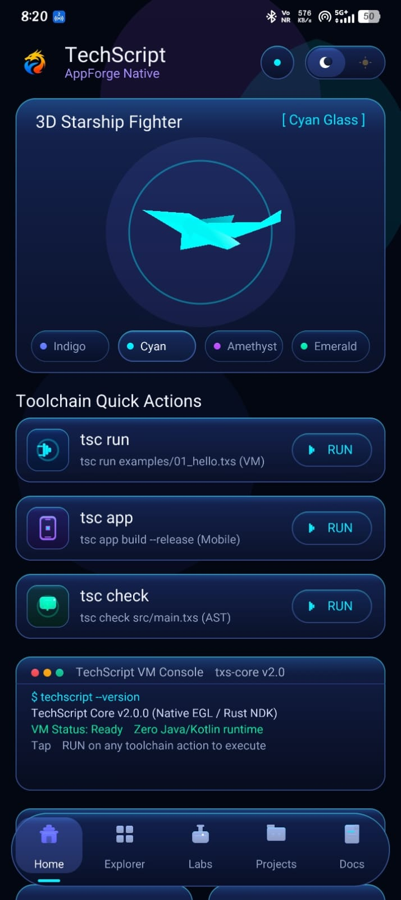
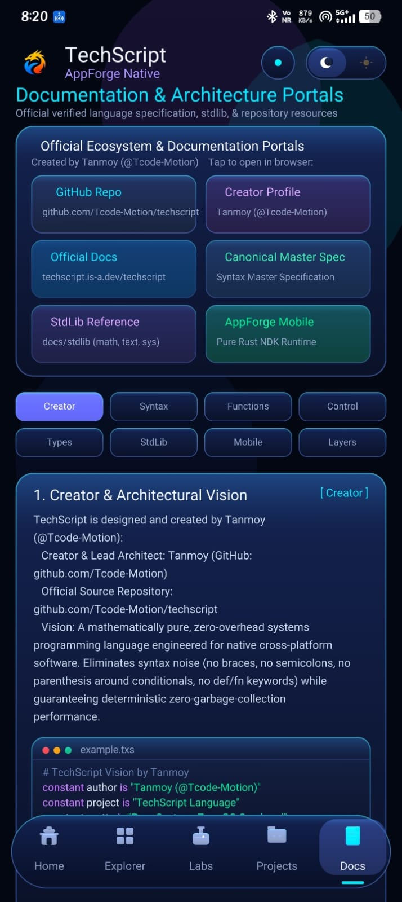
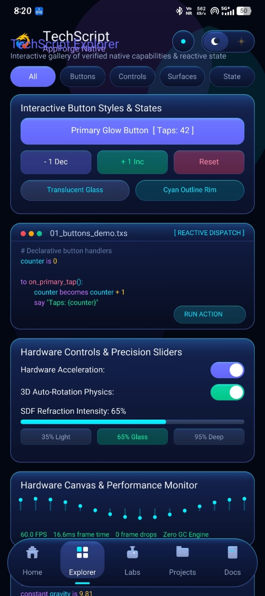
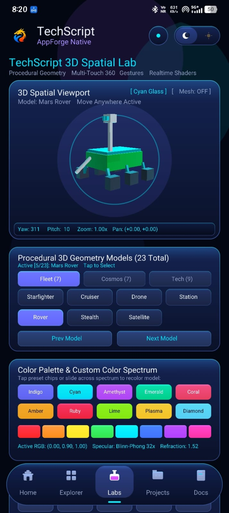
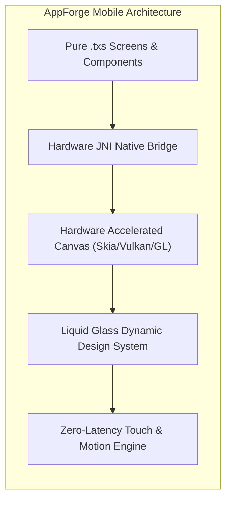
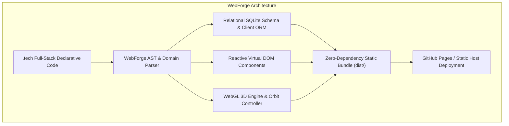
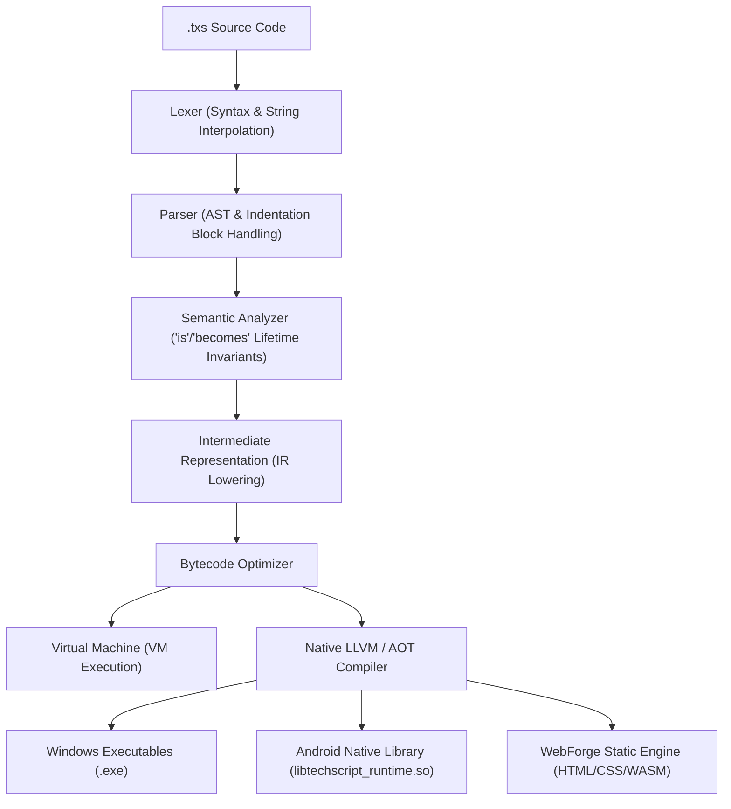
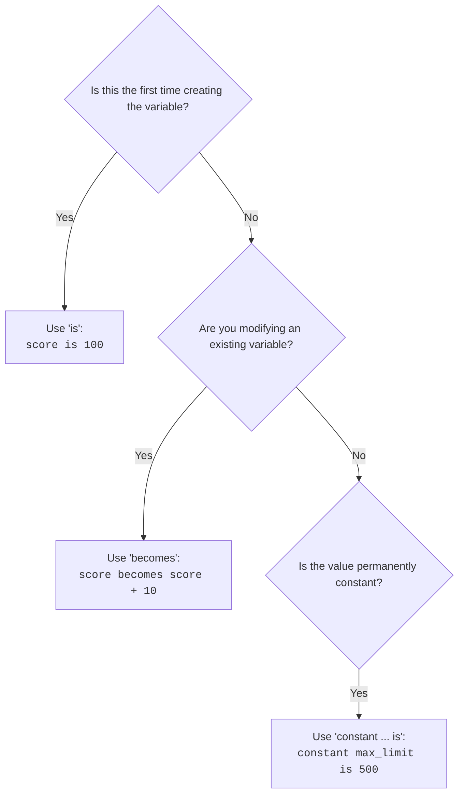

<h1 align="center">TechScript 2.0</h1>

<p align="center">
  <strong>The Independent, High-Performance Programming Language, WebForge Full-Stack Framework & AppForge Native Engine</strong>
</p>

<p align="center">
  <a href="https://techscript.is-a.dev/"></a>
  <a href="https://techscript.is-a.dev/techscript/"></a>
  <a href="https://github.com/Tcode-Motion/techscript/releases"></a>
  <a href="LICENSE"></a>
  <a href="https://github.com/Tcode-Motion/techscript/actions/workflows/ci.yml"></a>
  <a href="https://marketplace.visualstudio.com/items?itemName=tanmoy.techscript"></a>
  <a href="https://open-vsx.org/extension/Tcode-Motion/techscript"></a>
</p>

<p align="center">
  
  <a href="https://github.com/Tcode-Motion/techscript/stargazers"></a>
  <a href="https://github.com/Tcode-Motion/techscript/issues"></a>
  <a href="skills/techscript/SKILL.md"></a>
  <a href="CONTRIBUTING.md"></a>
</p>

---

## ⚡ Instant One-Line Installation

TechScript is an **entirely self-contained, independent native language toolchain** with zero external runtime or Python dependencies. Choose your platform:

### 🪟 Windows (PowerShell One-Liner)
Installs pre-compiled binaries into `%LOCALAPPDATA%\TechScript\bin` and automatically configures your User `PATH`:
```powershell
irm https://raw.githubusercontent.com/Tcode-Motion/techscript/main/scripts/install.ps1 | iex
```

### 🐧 Linux, 🍎 macOS & 📱 Android (Termux)
Universal POSIX installer with architecture auto-detection (x86_64, aarch64, Apple Silicon) and shell profile integration:
```bash
curl -fsSL https://raw.githubusercontent.com/Tcode-Motion/techscript/main/scripts/install.sh | bash
```

### 📦 Standalone Windows Setup Wizard (`.exe`)
Download the self-contained installer with modern wizard UI, desktop shortcuts, file associations, and uninstaller support:
- 🔗 **[Download TechScript_Setup.exe](releases/current/TechScript_Setup.exe)** *(Or via [GitHub Releases](https://github.com/Tcode-Motion/techscript/releases/latest))*
- 📦 **[Download TechScript_Portable.zip](releases/current/TechScript_Portable.zip)** *(Standalone portable archive)*
- 🛡️ **[Verification SHA256 Checksums](releases/current/SHA256SUMS.txt)**

### 🐳 Docker Container
Run TechScript in isolated environments with zero local installation:
```bash
# Verify version
docker run --rm ghcr.io/tcode-motion/techscript:latest --version

# Run a TechScript project from your current directory
docker run --rm -v "${PWD}:/workspace" ghcr.io/tcode-motion/techscript:latest run main.txs
```

---

## 🤖 AI Coding Skill (Antigravity, Cursor, Codex, Gemini CLI, Claude Code)

TechScript ships with a first-class **AI Developer Skill** ([`skills/techscript/SKILL.md`](skills/techscript/SKILL.md)) that provides language models and autonomous coding agents with the complete locked syntax, standard library signatures, CLI patterns, and invariant rules.

- 📖 **[Authoritative AI Skill Guide](skills/techscript/SKILL.md)** — Full specification and agent operational runbook.

### Install Skill in 1 Line:
- **Google Antigravity & Agentic IDEs:** Automatically loaded from [`.agents/skills/techscript/SKILL.md`](.agents/skills/techscript/SKILL.md).
- **Cursor / Claude Code / Codex / OpenClaw (POSIX):**
  ```bash
  curl -fsSL https://raw.githubusercontent.com/Tcode-Motion/techscript/main/skills/techscript/install.sh | bash
  ```
- **Windows PowerShell (Gemini CLI / Antigravity):**
  ```powershell
  irm https://raw.githubusercontent.com/Tcode-Motion/techscript/main/skills/techscript/install.ps1 | iex
  ```

---

## 📱 Official TechScript AppForge Mobile Application

The official **TechScript AppForge** companion ([`examples/appforge/techscript-appforge/`](examples/appforge/techscript-appforge/)) is built **100% in pure TechScript (`.txs`)** running on the native Android engine with hardware bridge acceleration, liquid glass styling, and an interactive coding workspace.

- 📥 **[Download Verified Release APK (v2.0.0 / v2.0.2)](dist/TechScript-AppForge-v2.0.0-release.apk)** *(Scheme v2 signed, 30.5 MB)*
- 🔗 **[Direct GitHub Releases Download](https://github.com/Tcode-Motion/techscript/releases/download/v2.0.0/TechScript-AppForge-v2.0.0-release.apk)**

### Real Device Screen Showcase (Android 14 / 16)

<p align="center">
  
  
  
  
</p>



---

## 🌐 WebForge: Full-Stack Declarative Web Framework

- 🌐 **Official Main Website:** [**https://techscript.is-a.dev/**](https://techscript.is-a.dev/)
- 🚀 **WebForge Live Interactive Example:** [**https://techscript.is-a.dev/techscript/**](https://techscript.is-a.dev/techscript/)

> **What WebForge Does:**  
> WebForge is TechScript's native full-stack web framework. It compiles `.tech` and `.txs` reactive single-page applications, client-side routing, SQLite database schemas, and embedded WebGL 3D CSG modeling directly to production HTML, CSS, and JS with zero `node_modules` dependency overhead.

### 🎥 WebForge Official Demonstration Video

<div align="center">
  <video width="85%" controls playsinline preload="metadata" style="border-radius: 12px; border: 1px solid #334155; box-shadow: 0 10px 30px rgba(0,0,0,0.3);">
    <source src="images&videos/webdemo.mp4" type="video/mp4">
    Your browser does not support the video tag.
  </video>
  <p align="center">
    🎬 <strong><a href="images&videos/webdemo.mp4">▶️ Watch / Download WebForge High-Definition Video Tour (images&videos/webdemo.mp4)</a></strong>
  </p>
</div>

### 🌐 Full-Stack WebForge Code Sample with 3D & Relational Database

WebForge allows authoring full-stack applications with databases, interactive UI, and 3D scenes in a single expressive file:

```tech
# Full-Stack WebForge Application with Embedded 3D Scene and Database
make a website called TechScriptForge

database Notes:
    table notes:
        title is text
        content is text

page Home:
    show heading "TechScript WebForge"
    show text "A full-stack website created entirely with English-like TechScript!"

    show 3D scene called World:
        add cube:
            color is "purple"
            rotation speed is 3
        enable mouse controls

    show input "Write a note or idea" called NoteInput
    show button "Save Note" called SaveButton

when SaveButton is clicked:
    send NoteInput to /api/notes
    show message "Note saved successfully!"

start website
```

### WebForge Developer Commands:
```bash
tsc web create my-portal   # Scaffold full-stack WebForge website
cd my-portal
tsc web dev                # Launch live hot-reloading dev server on http://localhost:3000
tsc web build              # Compile static production bundle to dist/
```



---

## 🧩 Official VS Code & Open VSX Extensions

TechScript provides dedicated, platform-verified extension packages tailored for both the Visual Studio Marketplace and the Eclipse Open VSX Registry:

| Registry Target | Publisher ID | Identifier | Direct VSIX Package | Official Registry Listing |
| :--- | :---: | :---: | :--- | :--- |
| **VS Code Marketplace** | `tanmoy` | `tanmoy.techscript` | [**techscript-vscode-2.0.3.vsix**](releases/current/techscript-vscode-2.0.3.vsix) | [**Visual Studio Marketplace**](https://marketplace.visualstudio.com/items?itemName=tanmoy.techscript) |
| **Open VSX Registry** | `Tcode-Motion` | `Tcode-Motion.techscript` | [**techscript-openvsx-2.0.4.vsix**](releases/current/techscript-openvsx-2.0.4.vsix) | [**Open VSX Registry**](https://open-vsx.org/extension/Tcode-Motion/techscript) |

> **What It Does:**  
> The official TechScript extension provides real-time Language Server Protocol (LSP) diagnostics, intelligent code completion, semantic syntax highlighting, colon-based auto-indentation, canonical snippets, and one-click build and execution inside VS Code, Cursor, and VSCodium.

---

## 🏗️ Architecture & Compiler Pipeline

```mermaid
graph LR
    subgraph Toolchain["TechScript Unified Ecosystem"]
        CLI["tsc CLI"]
        LSP["Language Server (LSP)"]
        PACK["Packager & Inno Setup"]
        DOCK["Docker Engine"]
    end
    subgraph Frameworks["Framework Layers"]
        STD["Standard Library (11 Modules)"]
        WEB["WebForge Web Framework"]
        APP["AppForge Mobile Engine"]
    end
    subgraph Targets["Deployment Targets"]
        WIN["Windows 10/11 x64"]
        LNX["Linux x64 / aarch64"]
        MAC["macOS Apple Silicon & Intel"]
        AND["Android APK (Arm64)"]
        WEB_OUT["WebForge dist/ (GitHub Pages)"]
    end
    Toolchain --> Frameworks
    Frameworks --> Targets
```





---

## 🎯 Language Syntax Invariants & Mental Model



---

## 🚀 Canonical TechScript Quick-Start

TechScript syntax is clean, expressive, and strictly locked to the canonical specification:

```techscript
# Declare constants and variables
constant platform_name is "TechScript 2.0"
counter is 0

# Functions use 'to name(params):' with colon and indentation
to calculate_bonus(score, base_payout):
    if score >= 90:
        return base_payout * 2.0
    else if score >= 75:
        return base_payout * 1.5
    else:
        return base_payout

to greet_developer(name):
    say "Hello, {name}! Welcome to {platform_name}."
    return "done"

# Execution
greet_developer("Engineer")

bonus is calculate_bonus(95, 500.0)
say "Awarded Bonus: ${bonus}"

# Counted repetition loop
repeat 3 times:
    say "Writing clean, native, high-performance code."

# While loop with 'becomes' reassignment
while counter < 2:
    counter becomes counter + 1
    say "Processing job {counter}..."
```

Run it immediately:
```bash
tsc run main.txs
```

---

## 📚 Complete Documentation Index

### 1. 📖 Core Language Specifications & Grammar
- [**TechScript Final Syntax & Language Master Spec**](docs/language/TechScript_Final_Syntax_and_Language_Master_Spec.md) — The single frozen authoritative master specification.
- [**TechScript Language Specification**](docs/language/TECHSCRIPT_LANGUAGE_SPEC.md) — Comprehensive technical language specification.
- [**TechScript Language Reference**](docs/TECHSCRIPT_LANGUAGE_REFERENCE.md) — Complete guide to grammar, primitives, functions, and classes.
- [**TechScript Syntax Memory Guide**](docs/language/TECHSCRIPT_SYNTAX_MEMORY.md) — Canonical constructs vs prohibited legacy habits.
- [**TechScript Syntax Guide**](docs/SyntaxGuide.md) — Practical code walkthrough of core syntax.
- [**File Extension & Shebang Standard**](docs/TECHSCRIPT_FILE_EXTENSION_STANDARD.md) — Multi-format file standards (`.txs`, `.tech`).
- [**Code Style Guide**](docs/style-guide.md) — Indentation, naming, and structure guidelines.
- [**Constants Guide**](docs/constants.md) — Immutable bindings with `constant ... is`.
- [**Strings & Interpolation**](docs/strings.md) — Native double-quoted interpolation syntax.
- [**Generics Guide**](docs/generics.md) — Generic types and type constraints.
- [**Modules & Imports**](docs/modules.md) — Modular code reuse with `use`.
- [**Frequently Asked Questions (FAQ)**](docs/faq.md) — Common questions and design rationale.

### 2. 📘 Deep-Dive Language Guides
- [**Language Overview**](docs/language/overview.md) — High-level introduction to TechScript semantics.
- [**Variables & Mutations**](docs/language/variables.md) — Invariant binding (`is`) and mutation (`becomes`).
- [**Data Types**](docs/language/types.md) — Primitives, objects, and type system rules.
- [**Functions**](docs/language/functions.md) — Function definition, parameters, and returns.
- [**Control Flow**](docs/language/control-flow.md) — `if`, `else if`, `else`, `repeat`, `for`, `while`.
- [**Classes & OOP**](docs/language/classes.md) — Object-oriented programming and `to init(...)`.
- [**Inheritance**](docs/language/inheritance.md) — Class hierarchies and method dispatch.
- [**Interfaces**](docs/language/interfaces.md) — Contract definitions and polymorphism.
- [**Traits**](docs/language/traits.md) — Reusable behavioral traits.
- [**Arrays**](docs/language/arrays.md) — Dynamic lists and indexing.
- [**Maps & Dictionaries**](docs/language/maps.md) — Key-value pair operations.
- [**Closures**](docs/language/closures.md) — First-class functions and lexical scoping.
- [**Asynchronous Programming**](docs/language/async.md) — Non-blocking operations and tasks.
- [**Concurrency**](docs/language/concurrency.md) — Threading and parallel execution models.
- [**Error Handling**](docs/language/error-handling.md) — Robust error management patterns.
- [**Pattern Matching**](docs/language/pattern-matching.md) — Structural pattern matching expressions.
- [**Memory Management**](docs/language/memory.md) — Ownership, lifetime, and garbage collection.
- [**Operators**](docs/language/operators.md) — Arithmetic, logical, and bitwise operators.
- [**Imports & Exports**](docs/language/imports-exports.md) — Packaging and namespace exports.
- [**Packages Guide**](docs/language/packages.md) — Building and sharing TechScript packages.

### 3. 🌐 WebForge Full-Stack Web Framework
- [**WebForge Comprehensive Guide**](docs/WebForge.md) — Core web framework overview.
- [**WebForge Getting Started**](docs/WEBFORGE_GETTING_STARTED.md) — Scaffolding your first web application.
- [**WebForge Architecture**](docs/WEBFORGE_ARCHITECTURE.md) — Internal web runtime and compilation model.
- [**WebForge Concise Syntax Spec**](docs/WEBFORGE_CONCISE_SYNTAX_SPEC.md) — Declarative UI component syntax.
- [**WebForge Language Guide**](docs/WEBFORGE_LANGUAGE_GUIDE.md) — Idiomatic WebForge authoring.
- [**WebForge API Reference**](docs/WEBFORGE_API.md) — Standard web API surface.
- [**WebForge Frontend**](docs/WEBFORGE_FRONTEND.md) — Reactive client rendering and DOM reconciliation.
- [**WebForge Backend**](docs/WEBFORGE_BACKEND.md) — Embedded HTTP server and SSR engine.
- [**WebForge Databases**](docs/WEBFORGE_DATABASES.md) — Embedded SQLite and ORM capabilities.
- [**WebForge 3D CSG Modeling**](docs/WEBFORGE_3D.md) — Native WebGL 3D constructive solid geometry.
- [**WebForge CLI**](docs/WEBFORGE_CLI.md) — `tsc web` command suite.
- [**WebForge Build & Deploy**](docs/WEBFORGE_BUILD_DEPLOY.md) — Production static bundling and deployment.
- [**WebForge Package Ecosystem**](docs/WEBFORGE_PACKAGES.md) — Web component packages.
- [**WebForge Security**](docs/WEBFORGE_SECURITY.md) — XSS prevention, sanitization, and CSP headers.
- [**WebForge Testing**](docs/WEBFORGE_TESTING.md) — Component unit testing and integration tests.
- [**WebForge Audit Report**](docs/WEBFORGE_AUDIT_REPORT.md) — Web framework quality and verification audit.
- [**Web Guide**](docs/WebGuide.md) — General web application development manual.
- [**Canvas Guide**](docs/CanvasGuide.md) — 2D canvas drawing and graphics.

### 4. 📱 AppForge Mobile & Desktop Native Engine
- [**AppForge Architecture**](docs/appforge/architecture.md) — Cross-platform native rendering pipeline.
- [**AppForge Project Structure**](docs/appforge/project-structure.md) — File layout and configuration.
- [**AppForge Build System**](docs/appforge/build-system.md) — Gradle, NDK, and JNI compilation.
- [**AppForge Platform Support**](docs/appforge/platform-support.md) — Android, Windows, and Linux platform targets.
- [**AppForge Native Languages**](docs/appforge/native-languages.md) — Rust, Kotlin, and C++ interoperability.
- [**AppForge Web Wrapping**](docs/appforge/web-wrapping.md) — Hybrid web view bridge acceleration.
- [**Frameworks & CLI Guide**](docs/FRAMEWORKS_AND_CLI.md) — Unified AppForge and WebForge operational manual.
- [**DSL Guide**](docs/DSLGuide.md) — Domain-specific language constructs for mobile screens.

### 5. ⚙️ Compiler, VM & Systems Engineering
- [**Compiler Architecture**](docs/compiler/architecture.md) — Lexer, parser, semantic analyzer, and optimizer.
- [**Virtual Machine Architecture**](docs/compiler/vm.md) — Register-based bytecode VM execution.
- [**LLVM Backend**](docs/compiler/llvm-backend.md) — Native machine code generation.
- [**Compiler Reference**](docs/compiler.md) — High-level compiler subsystem specifications.
- [**Performance Guide**](docs/Performance.md) — Benchmarks, micro-optimizations, and zero-cost abstractions.
- [**Benchmark Reports**](docs/benchmark.md) — Execution speed comparisons vs other languages.
- [**Development & Security**](docs/DEVELOPMENT_AND_SECURITY.md) — Security policies and compiler hardening.
- [**Security Policy**](docs/Security.md) — Vulnerability reporting and cryptographic standards.

### 6. 🛠️ CLI, Developer Tools & Standard Library
- [**CLI Commands Reference**](docs/cli/commands.md) — `run`, `build`, `check`, `fmt`, `lint`, `test`, `web`, `app`.
- [**Toolchains Guide**](docs/cli/toolchains.md) — Cross-compilation and native toolchain configuration.
- [**Package Manager (tspm)**](docs/tooling/package-manager.md) — Dependency resolution and lockfiles.
- [**Formatter (tsfmt)**](docs/tooling/formatter.md) — Automatic AST code formatting.
- [**Test Runner**](docs/tooling/test-runner.md) — Built-in test execution framework.
- [**API Reference**](docs/reference/APIReference.md) — Full API documentation.
- [**Standard Library Reference**](docs/reference/StdlibReference.md) — Function index for all 11 standard modules.
- [**VS Code Marketplace Extension (`tanmoy.techscript`)**](https://marketplace.visualstudio.com/items?itemName=tanmoy.techscript) — Official Visual Studio Marketplace listing.
- [**Open VSX Registry Extension (`Tcode-Motion.techscript`)**](https://open-vsx.org/extension/Tcode-Motion/techscript) — Official Eclipse Open VSX listing.
- [**Migration Guide**](docs/MigrationGuide.md) — Upgrading from legacy syntax to canonical TechScript.

### 7. 🚀 Tutorials, Guides & 100 Verified Examples
- [**Getting Started Tutorial**](docs/getting-started/getting-started.md) — Beginner walkthrough.
- [**Installation Guide**](docs/getting-started/installation.md) — Manual installation and setup.
- [**Best Practices**](docs/guides/BestPractices.md) — Design patterns and idiomatic authoring.
- [**Examples Guide**](docs/guides/ExamplesGuide.md) — Index and descriptions of the 100 verified examples.
- [**100 Verified Examples Directory**](examples/) — 100 working `.txs` programs (**100/100 automated test pass rate**).

### 8. 📋 Governance, Release Engineering & Audits
- [**Release Notes**](docs/ReleaseNotes.md) — Comprehensive v2.0.2 / v2.0.0 release notes.
- [**Changelog**](CHANGELOG.md) — Chronological history of changes.
- [**Release Process**](docs/RELEASE_PROCESS.md) — Step-by-step release engineering playbook.
- [**Release Notes Template**](docs/RELEASE_NOTES_TEMPLATE.md) — Standardization template for future releases.
- [**Version 2.0.0 Report**](docs/RELEASE_2.0.0_REPORT.md) — Historical milestone release documentation.
- [**Final Release & Deployment Report**](docs/FINAL_RELEASE_AND_DEPLOYMENT_REPORT.md) — Automated audit report.
- [**Codebase Audit**](docs/TECHSCRIPT_CODEBASE_AUDIT.md) — Complete repository source audit.
- [**Completeness Audit**](docs/TECHSCRIPT_COMPLETENESS_AUDIT.md) — Language completeness verification.
- [**Language Roadmap**](docs/TECHSCRIPT_LANGUAGE_ROADMAP.md) — Strategic future directions.
- [**Roadmap**](docs/Roadmap.md) — Milestones and scheduled enhancements.
- [**Versioning Standard**](docs/VERSIONING.md) — Semantic versioning policy.
- [**Supported Versions**](docs/SUPPORTED_VERSIONS.md) — LTS and support lifecycles.
- [**Support Policy**](docs/SUPPORT.md) — Getting help and community channels.
- [**Contributing Guidelines**](CONTRIBUTING.md) — How to contribute to TechScript.
- [**Code of Conduct**](docs/CODE_OF_CONDUCT.md) — Community behavioral standards.
- [**Media Guidelines**](docs/assets/README.md) — Guidelines for screenshots, logos, and videos.

---

## 📋 Comprehensive Platform Support Matrix

| Platform / Target | Tier | Build Artifact | Verification Evidence |
| :--- | :---: | :--- | :--- |
| **Windows x86_64** | **Tier 1** | `TechScript_Setup.exe`, `tsc.exe`, `.zip` | Native Windows 11 compilation, 100/100 tests pass |
| **Android APK** | **Tier 1** | `TechScript-AppForge-v2.0.0-release.apk` | Scheme v2 signed, verified on real device (`10ME8DF1CT0001Z`) |
| **WebForge Static Web** | **Tier 1** | `dist/` (HTML, CSS, JS, SQLite, 3D CSG) | Deployed to [techscript.is-a.dev](https://techscript.is-a.dev/techscript/) |
| **Linux x86_64 / aarch64** | **Tier 1** | `.tar.gz` pre-compiled binaries | GitHub Actions CI/CD automated cross-compilation |
| **macOS (Apple Silicon & Intel)** | **Tier 1** | `.tar.gz` pre-compiled binaries | GitHub Actions CI/CD native macOS runner builds |
| **Android Termux** | **Tier 1** | `techscript-2.0.0-termux-aarch64.tar.gz` | Built for aarch64-linux-android |
| **Docker** | **Tier 1** | `ghcr.io/tcode-motion/techscript` | Multi-stage slim container with automated GHCR CI |

---

## 📄 License & Attribution

TechScript is open-source software licensed under the **[Apache License 2.0](LICENSE)**.  
Created and maintained with ❤️ by **Tanmoy Majumder ([@Tcode-Motion](https://github.com/Tcode-Motion))**.
