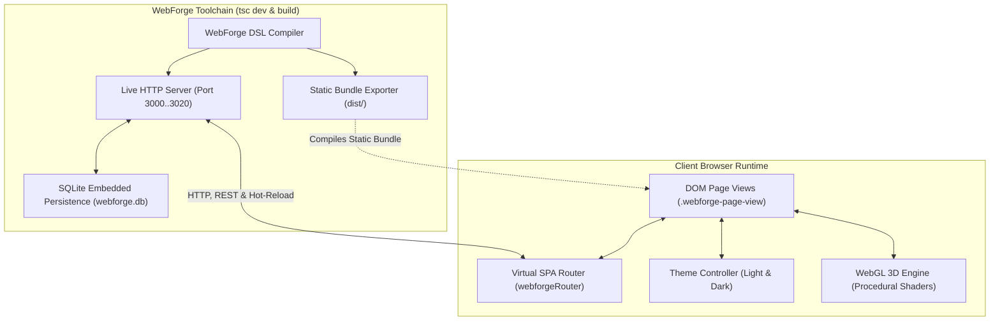
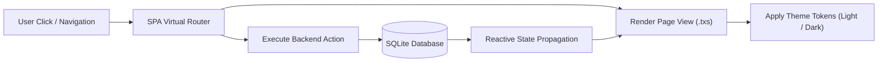
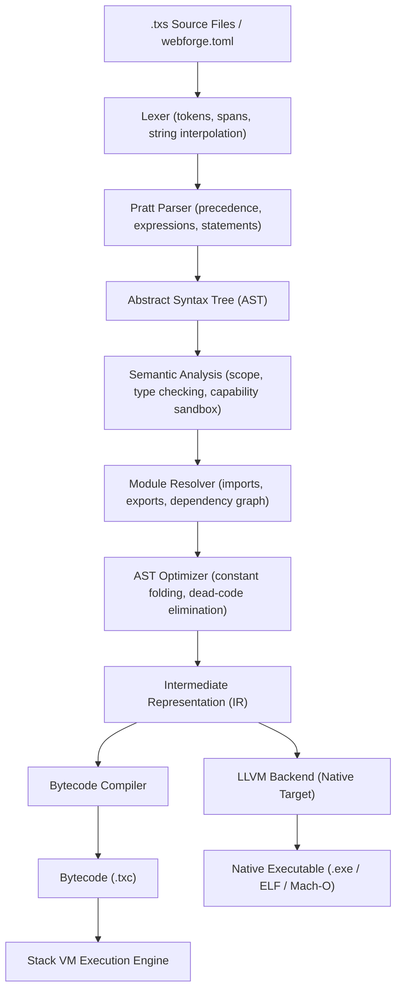
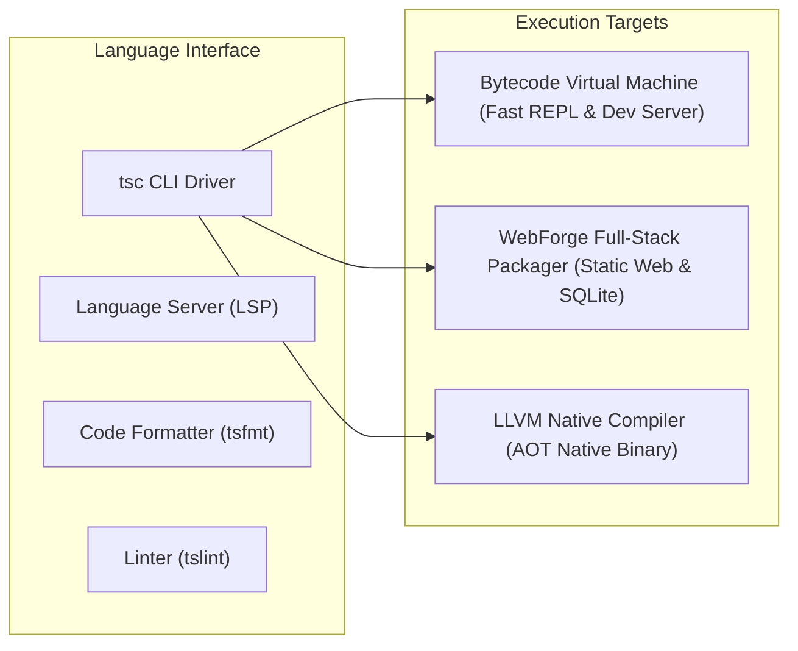

<p align="center">
  
</p>

<h1 align="center">TechScript</h1>

<p align="center">
  <strong>The Modern, Human-Readable Programming Language & WebForge Full-Stack Toolchain</strong>
</p>

<p align="center">
  <a href="https://github.com/Tcode-Motion/techscript/releases"></a>
  <a href="LICENSE"></a>
  <a href="https://github.com/Tcode-Motion/techscript/actions/workflows/ci.yml"></a>
  <a href="https://is-a.dev/techscript/"></a>
  <a href="#installation"></a>
</p>

<p align="center">
  
  <a href="https://github.com/Tcode-Motion/techscript/stargazers"></a>
  <a href="https://github.com/Tcode-Motion/techscript/network/members"></a>
  <a href="https://github.com/Tcode-Motion/techscript/issues"></a>
  <a href="CONTRIBUTING.md"></a>
  
</p>

---

## Table of Contents

- [Overview](#overview)
- [Key Features](#key-features)
- [Standalone Architecture](#standalone-architecture--zero-rustcargo-dependency)
- [WebForge Framework Deep-Dive](#webforge-framework-deep-dive)
  - [Framework Architecture](#framework-architecture)
  - [Reactive Data & Navigation Flow](#reactive-data--navigation-flow)
  - [Scaffolding a Website](#scaffolding-a-website)
  - [Declarative UI Components](#declarative-ui-components)
  - [SQLite Database & Reactive State](#sqlite-database--reactive-state)
  - [Native 3D WebGL Engine](#native-3d-webgl-engine)
  - [Adaptive Design System](#adaptive-design-system-light--dark)
- [Language Guide & Code Examples](#language-guide--code-examples)
  - [Variables & Control Flow](#variables--control-flow)
  - [Functions & Returns](#functions--returns)
  - [Object-Oriented Programming](#object-oriented-programming)
  - [Structs, Enums & Pattern Matching](#structs-enums--pattern-matching)
  - [Async, Concurrency & Parallelism](#async-concurrency--parallelism)
- [Standard Library](#standard-library)
- [Architecture & Toolchain Flowcharts](#architecture--toolchain-flowcharts)
  - [Compiler & Lowering Pipeline](#compiler--lowering-pipeline)
  - [Runtime & Execution Backends](#runtime--execution-backends)
- [Installation](#installation)
- [CLI Reference](#cli-reference)
- [Project Templates](#project-templates)
- [Contributing & Policies](#contributing--policies)
- [License](#license)

---

## Overview

**TechScript** (`.txs`) is a modern, strongly-typed programming language engineered for human clarity, expressive readability, and high performance. By replacing punctuation-heavy bracket syntax with explicit, natural English keywords (`do`, `when`, `else`, `loop`, `repeat`, `try`, `catch`, `end`), TechScript eliminates syntax fatigue while preserving the full power of modern systems: static typing, object-oriented abstractions, concurrency, pattern matching, and native compilation.

TechScript ships with **WebForge**, an integrated full-stack web framework that allows developers to build responsive websites, declarative single-page applications, reactive database backends, and zero-dependency WebGL 3D experiences directly in TechScript.

```txs
// app.txs — A complete interactive website in TechScript
make a website called "MyStudio"

header:
    title is "MyStudio"
    nav:
        link:
            label is "Home"
            url is "/"
        link:
            label is "Docs"
            url is "https://is-a.dev/techscript/"

start website
```

---

## Key Features

- **Expressive English Syntax**: Structured keywords (`do`, `end`, `when`, `repeat`, `send`) make code read like clean architecture descriptions.
- **Unified Toolchain (`tsc`)**: Single CLI driver for running, building, testing, formatting, linting, package management, and serving.
- **Standalone Independence**: Pre-compiled single executable. **No Rust, Cargo, or external compilers are required** on the user's machine.
- **WebForge Full-Stack Engine**: Scaffolds, runs, and compiles complete web applications with client-side SPA routing, SQLite persistence, and 3D WebGL scenes.
- **Adaptive Design System**: Built-in glassmorphism styling, curated typography (Outfit, Inter, JetBrains Mono), responsive grids, and instant light/dark theme toggling.
- **Multi-Backend Runtime**: Fast bytecode compiler with a register-and-stack VM for development, and native compilation for production deployments.
- **Batteries Included**: Comprehensive standard library covering filesystem, networking, HTTP servers, cryptography, databases, JSON/CSV/YAML parsing, and 2D canvas drawing.

---

## Standalone Architecture — Zero Rust/Cargo Dependency

TechScript is designed to be completely independent:
- **No Rust or Cargo Required**: End users and web developers never need Rust or build tools installed on their machine.
- **Self-Contained Executable**: The `tsc` binary (as well as `webforge` and `techscript`) contains the entire lexer, Pratt parser, semantic analyzer, optimizer, bytecode VM, WebForge server, and packager.
- **Direct OS Integration**: Compiles directly against native OS libraries (`kernel32.dll`, `libc`). Portable zip archives and one-line installers are available for Windows, macOS, Linux, and Android (Termux).

---

## WebForge Framework Deep-Dive

WebForge is the official full-stack web framework built directly into TechScript. It bridges high-level declarative UI composition with backend persistence and client rendering.

### Framework Architecture



#### Reactive Data & Navigation Flow




### Scaffolding a Website

Create a production-ready website with a single command:

```bash
tsc new website my-site
cd my-site
tsc dev
```

The WebForge live development server starts instantly on `http://localhost:3000` (with automatic port scanning if occupied) featuring live hot-reload.

### Declarative UI Components

WebForge projects structure user interfaces into modular `.txs` files:

#### 1. Entrypoint (`app.txs`)
```txs
make a website called "Acme Cloud"

header:
    title is "Acme Cloud"
    nav:
        link:
            label is "Home"
            url is "/"
        link:
            label is "About"
            url is "/about"
        link:
            label is "Docs"
            url is "https://is-a.dev/techscript/"

footer:
    section:
        title is "Product"
        link:
            label is "Features"
            url is "/"
        link:
            label is "About"
            url is "/about"
    section:
        title is "Resources"
        link:
            label is "Documentation"
            url is "https://is-a.dev/techscript/"
        link:
            label is "GitHub"
            url is "https://github.com/Tcode-Motion/techscript"

start website
```

#### 2. Pages (`pages/home.txs`)
```txs
page Home "/":
    hero:
        title is "Enterprise Cloud Storage"
        subtitle is "Fast, secure, and decentralized cloud infrastructure powered by TechScript WebForge."
        button "Get Started" -> open "https://is-a.dev/techscript/"
        button "Learn More" -> open "/about"

    section:
        title is "Core Infrastructure"
        card:
            title is "Global CDN"
            badge is "Edge"
            text is "Sub-millisecond static and dynamic asset delivery across 240 global edge regions."
        card:
            title is "Zero-Knowledge Encryption"
            badge is "Security"
            text is "End-to-end cryptographic proofs ensuring data sovereignty and privacy."
        card:
            title is "Real-Time Sync"
            badge is "Database"
            text is "Native SQLite multi-master replication with built-in reactive subscriptions."
```

### SQLite Database & Reactive State

WebForge embeds a zero-configuration SQLite database engine. Declare schemas, tables, and query data directly in TechScript:

```txs
database "inventory_db"

table "products":
    column "id" is integer primary key autoincrement
    column "name" is text not null
    column "price" is real
    column "stock" is integer

action "add_product":
    insert into "products" (name, price, stock) values ("Cloud VPS", 19.99, 50)
```

### Native 3D WebGL Engine

WebForge features a lightweight, zero-dependency procedural 3D WebGL engine for interactive product showcases:

```txs
scene3d "cube_showcase":
    mesh "cube":
        geometry is "box"
        color is "#0284C7"
        roughness is 0.2
        metalness is 0.8
        rotate x is 0.5 y is 1.0

    camera:
        position is [0, 2, 5]
        orbit is true

    light:
        type is "directional"
        intensity is 1.5
```

### Adaptive Design System (Light & Dark)

WebForge components are styled with an adaptive design system:
- **Clean Light Mode (Default)**: Modern slate surfaces (`#F8FAFC`, `#FFFFFF`), crisp borders (`#E2E8F0`), vibrant tech accents (`#0284C7`), and legible typography.
- **Sleek Cyber Dark Mode**: Deep obsidian backgrounds (`#08090E`), elevated glassmorphic panels (`#10141D`), and radiant cyan glows.
- **One-Click Theme Toggle**: Persistent client-side theme switcher built into the navigation header.

---

## Language Guide & Code Examples

### Variables & Control Flow

```txs
// Variable and constant bindings
name = "TechScript"
const version = 2.0
const is_active = true

// Conditional evaluation with when/else
when version >= 2.0
    say $"Running modern {name} v{version}"
else
    say "Legacy environment detected"
end

// Loops
for number in [1, 2, 3, 4, 5]
    say $"Index: {number}"
end

// Counted loop
loop 3
    say "Pinging cluster..."
end

// Condition-controlled repeat loop
counter = 0
repeat when counter < 3
    counter = counter + 1
    say $"Iteration {counter}"
end
```

### Functions & Returns

```txs
do calculate_tax(amount, rate)
    when rate < 0.0
        send 0.0
    end
    send amount * rate
end

total = calculate_tax(100.0, 0.18)
say $"Calculated Tax: {total}"
```

### Object-Oriented Programming

```txs
class Server
    name = ""
    port = 8080
    is_running = false

    do constructor(server_name, port_number)
        name = server_name
        port = port_number
    end

    do start()
        is_running = true
        say $"Server '{name}' listening on port {port}"
    end

    do stop()
        is_running = false
        say $"Server '{name}' stopped"
    end
end

api = new Server("API Gateway", 3000)
api.start()
```

### Structs, Enums & Pattern Matching

```txs
struct Point
    x: number
    y: number
end

enum Direction
    North,
    South,
    East,
    West
end

do step(dir)
    match dir
        when Direction.North
            send "Moving forward"
        when Direction.South
            send "Moving backward"
        else
            send "Turning sideways"
    end
end
```

### Async, Concurrency & Parallelism

```txs
async do fetch_telemetry()
    say "Requesting system telemetry..."
    data = await std.http.get("https://api.example.com/status")
    send data
end

// Parallel execution block
parallel
    task_a = std.math.sqrt(144)
    task_b = std.crypto.sha256("payload")
end
```

---

## Standard Library

The TechScript standard library (`stdlib/`) provides built-in modules for enterprise scripting and system tasks:

| Module | Identifier | Key Capabilities |
| --- | --- | --- |
| **System I/O** | `std.io` | Formatted console output, terminal interaction, colorization |
| **Filesystem** | `std.fs` | Read/write files, recursive directory walks, metadata inspection |
| **Networking & HTTP**| `std.http` | HTTP/HTTPS GET, POST, headers, cookies, REST clients |
| **Data Formats** | `std.json`, `std.csv`, `std.yaml`, `std.toml` | Parsing, serialization, structured transformation |
| **Databases** | `std.sqlite`, `std.database` | Embedded SQLite transactions, connection pooling, queries |
| **Cryptography** | `std.crypto` | SHA-256, SHA-512, MD5, AES-GCM encryption, Base64 |
| **Graphics & 2D** | `std.canvas` | Vector graphics rendering, PNG/JPEG export, chart generators |
| **Time & Math** | `std.time`, `std.math`, `std.random` | Nanosecond precision timers, trigonometry, statistical distributions |
| **Testing** | `std.testing` | `assert_eq`, test suites, mocking, benchmarker |

---

## Architecture & Toolchain Flowcharts

### Compiler & Lowering Pipeline



### Runtime & Execution Backends



---

## Installation

TechScript requires **no external dependencies, build tools, or Rust installation**.

### Windows

#### Automated PowerShell Install
```powershell
irm https://raw.githubusercontent.com/Tcode-Motion/techscript/main/scripts/install.ps1 | iex
```

#### Manual Download
1. Download `techscript-v2.0.0-windows-x86_64.zip` from [GitHub Releases](https://github.com/Tcode-Motion/techscript/releases).
2. Extract to `C:\Users\<User>\AppData\Local\TechScript\bin`.
3. Add the bin folder to your User `PATH`.

Verify the installation:
```powershell
tsc version
```

### Linux & macOS

```bash
curl -fsSL https://raw.githubusercontent.com/Tcode-Motion/techscript/main/scripts/install.sh | bash
```

### Python Bootstrap Installer

```bash
pip install techscript-lang
techscript install
```

### Android & Termux

```bash
pkg update && pkg install curl
curl -fsSL https://raw.githubusercontent.com/Tcode-Motion/techscript/main/scripts/install.sh | bash
```

---

## CLI Reference

The unified `tsc` binary (also symlinked as `webforge` and `techscript`) provides full control over development and deployment:

```text
Usage:
  tsc <command> [options]
  webforge <command> [options]
  techscript <command> [options]
```

| Command | Arguments | Description |
| --- | --- | --- |
| `tsc new` | `<template> <name>` | Scaffold a project (`website`, `fullstack`, `api`, `3d`, `console`, `cli`, `library`) |
| `tsc dev` | `[port]` | Start WebForge live development server with hot-reload (default: 3000) |
| `tsc run` | `<file.txs>` | Compile and run a script or package entrypoint |
| `tsc build` | `[--target web\|vm\|native]` | Compile project into web bundle, bytecode, or native binary |
| `tsc check` | `[file.txs]` | Perform semantic analysis and type checking without execution |
| `tsc test` | `[path]` | Run unit and integration tests (`*_test.txs`) |
| `tsc fmt` | `[--check]` | Automatically format all `.txs` source files |
| `tsc lint` | `[--fix]` | Lint codebase and automatically apply safe fixes |
| `tsc repl` | | Launch the interactive Read-Eval-Print Loop |
| `tsc add` | `<package>` | Install and register a dependency from the official package registry |
| `tsc doctor` | | Inspect environment health, paths, and platform capabilities |
| `tsc version`| `[--version]` | Print full toolchain version and component manifest |

---

## Project Templates

Scaffold pre-configured project architectures instantly:

```bash
# Modern WebForge Website (Pages, Hero, Cards, Light/Dark theme, SQLite)
tsc new website my-site

# Full-Stack WebForge Application with Server APIs & 3D WebGL scenes
tsc new fullstack my-app

# REST API microservice with embedded HTTP server and JSON routing
tsc new api my-api

# Standalone 3D WebGL Canvas Scene
tsc new 3d my-scene

# Command-line utility or tool
tsc new cli my-tool

# Standard software library
tsc new library my-lib
```

---

## Contributing & Policies

We welcome community contributions, language enhancements, and bug reports!

- **Contributing Guide**: [CONTRIBUTING.md](CONTRIBUTING.md) — Setup guidelines, branch strategy, testing rules, and pull request workflows.
- **Code of Conduct**: [.github/CODE_OF_CONDUCT.md](.github/CODE_OF_CONDUCT.md) — Community expectations and inclusive collaboration.
- **Security Policy**: [SECURITY.md](SECURITY.md) — Vulnerability reporting and patch timelines.
- **Official Documentation**: [https://is-a.dev/techscript/](https://is-a.dev/techscript/)
- **GitHub Discussions**: [https://github.com/Tcode-Motion/techscript/discussions](https://github.com/Tcode-Motion/techscript/discussions)
- **Issue Tracker**: [https://github.com/Tcode-Motion/techscript/issues](https://github.com/Tcode-Motion/techscript/issues)

---

## License

TechScript and the WebForge framework are distributed under the **[Apache License 2.0](LICENSE)**.

```text
Copyright 2026 Tcode-Motion / TechScript Contributors

Licensed under the Apache License, Version 2.0 (the "License");
you may not use this file except in compliance with the License.
You may obtain a copy of the License at

    http://www.apache.org/licenses/LICENSE-2.0

Unless required by applicable law or agreed to in writing, software
distributed under the License is distributed on an "AS IS" BASIS,
WITHOUT WARRANTIES OR CONDITIONS OF ANY KIND, either express or implied.
See the License for the specific language governing permissions and
limitations under the License.
```
