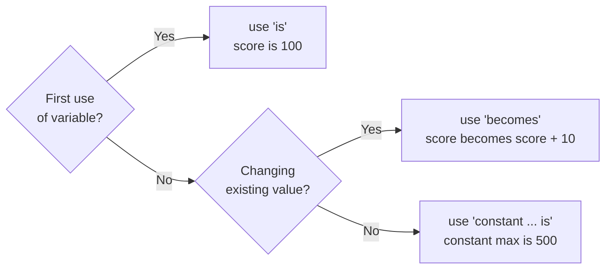
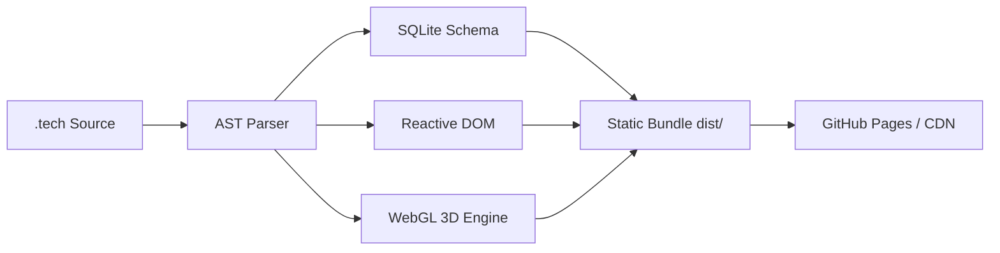
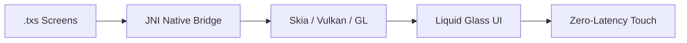
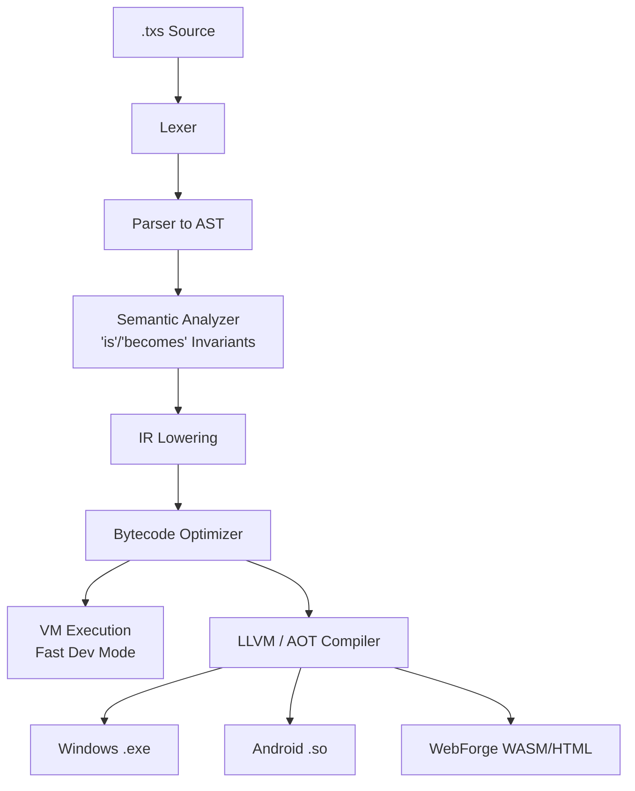
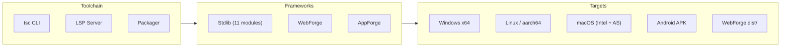

<p align="center">
  <a href="https://techscript.is-a.dev/">
    
  </a>
</p>

<h1 align="center">TechScript 2.0</h1>

<p align="center">
  <strong>Independent Programming Language &middot; WebForge Full-Stack Framework &middot; AppForge Native Engine</strong>
</p>

<p align="center">
  <a href="https://techscript.is-a.dev/"></a>
  <a href="https://techscript.is-a.dev/techscript/"></a>
  <a href="https://github.com/Tcode-Motion/techscript/releases"></a>
  <a href="LICENSE"></a>
  <a href="https://github.com/Tcode-Motion/techscript/actions/workflows/ci.yml"></a>
</p>

<p align="center">
  <a href="https://marketplace.visualstudio.com/items?itemName=tanmoy.techscript"></a>
  <a href="https://open-vsx.org/extension/Tcode-Motion/techscript"></a>
</p>

<p align="center">
  
  <a href="https://github.com/Tcode-Motion/techscript/stargazers"></a>
  <a href="https://github.com/Tcode-Motion/techscript/issues"></a>
  <a href="CONTRIBUTING.md"></a>
</p>

---

## Table of Contents

| # | Section |
|---|---------|
| 1 | [The Problem](#the-problem) |
| 2 | [The Solution](#the-solution-what-is-techscript-20) |
| 3 | [Why TechScript? (Comparison)](#why-techscript-feature-comparison) |
| 4 | [Installation](#instant-one-line-installation) |
| 5 | [Quick-Start Syntax](#canonical-syntax-quick-start) |
| 6 | [Syntax Mental Model](#syntax-mental-model--invariants) |
| 7 | [WebForge Framework](#webforge-full-stack-declarative-web-framework) |
| 8 | [AppForge Engine & Screenshots](#appforge-native-mobile--desktop-engine) |
| 9 | [Editor Extensions](#official-editor-extensions) |
| 10 | [AI Developer Skill](#ai-developer-skill) |
| 11 | [Architecture](#architecture--compiler-pipeline) |
| 12 | [Platform Support](#platform-support-matrix) |
| 13 | [Documentation Index](#complete-documentation-index) |
| 14 | [License](#license--attribution) |

---

## The Problem

Modern development is fragmented, bloated, and brittle:

| # | Problem | Impact |
|---|---------|--------|
| 1 | **Dependency Bloat** | Gigabytes of `node_modules`/venvs that break across OS boundaries |
| 2 | **Ecosystem Fragmentation** | Separate languages for web (JS), API (Python), mobile (Kotlin/Swift), native (Rust/C++) |
| 3 | **Ambiguous Mutations** | `let`/`var`/`const`/`:=` chaos creates subtle bugs and cognitive overload |
| 4 | **AI Hallucination** | Decades of competing idioms cause agents to hallucinate invalid syntax |

---

## The Solution: What is TechScript 2.0?

**TechScript 2.0** is an independent, high-performance general-purpose language built from first principles in native Rust, unified with **WebForge** (full-stack web) and **AppForge** (native mobile/desktop).

| Pillar | Detail |
|--------|--------|
| **English-Like Locked Syntax** | `is` (declare), `becomes` (mutate), `constant`, `to name():` — zero symbol noise |
| **Zero-Dependency Binary** | Ships as a single `tsc` binary — no Python, no Node.js, no external VM |
| **WebForge** | Reactive websites + SQLite + WebGL 3D in one `.tech` file to zero-dep static bundle |
| **AppForge** | Cross-platform Android/desktop in pure `.txs` with liquid-glass hardware-accelerated UI |
| **Locked AI Skill** | `SKILL.md` gives agents an immutable grammar spec — eliminates hallucinated syntax |
| **Dual Execution** | Ultra-fast register-based VM for dev + LLVM backend for native machine code |

---

## Why TechScript? (Feature Comparison)

| Feature | **TechScript 2.0** | Python 3 | TypeScript/Node | Go |
| :--- | :---: | :---: | :---: | :---: |
| External Runtime | **None** | Python Interpreter | Node / Bun | None |
| Dependency Bloat | **Zero** | venv/site-packages | Heavy node_modules | Minimal |
| Web Framework Built-in | **WebForge** | External (Django/Flask) | External (Next.js) | External |
| Mobile Engine Built-in | **AppForge** | External (Kivy) | External (RN) | Not suited |
| Locked AI Skill | **SKILL.md** | None | None | None |
| Syntax Invariants | **`is` / `becomes`** | Mutable by default | let/const/var | := vs = |
| Verified Test Suite | **100/100** | Varies | Varies | Varies |

---

## Instant One-Line Installation

> Zero prerequisites. Choose your OS:

**Windows (PowerShell)**
```powershell
Invoke-WebRequest -Uri https://raw.githubusercontent.com/Tcode-Motion/techscript/main/scripts/install.ps1 -OutFile install.ps1
.\install.ps1
```

**Linux / macOS / Android Termux**
```bash
curl -fsSL https://raw.githubusercontent.com/Tcode-Motion/techscript/main/scripts/install.sh -o install.sh
bash install.sh
```

**Standalone Packages**

| Package | Download |
|---------|----------|
| Windows Setup Wizard | [TechScript_Setup.exe](releases/current/TechScript_Setup.exe) — [GitHub Releases](https://github.com/Tcode-Motion/techscript/releases/latest) |
| Portable Archive | [TechScript_Portable.zip](releases/current/TechScript_Portable.zip) |
| SHA256 Checksums | [SHA256SUMS.txt](releases/current/SHA256SUMS.txt) |

**Docker**
```bash
docker run --rm ghcr.io/tcode-motion/techscript:latest --version
docker run --rm -v "${PWD}:/workspace" ghcr.io/tcode-motion/techscript:latest run main.txs
```

---

## Canonical Syntax Quick-Start

```python
# Constants and variables
constant platform_name is "TechScript 2.0"
counter is 0

# Functions: 'to name(params):' with colon + 4-space indent
to calculate_bonus(score, base_payout):
    if score >= 90:
        return base_payout * 2.0
    else if score >= 75:
        return base_payout * 1.5
    else:
        return base_payout

to greet_developer(name):
    say "Hello, {name}! Welcome to {platform_name}."

# Invocation
greet_developer("Engineer")
bonus is calculate_bonus(95, 500.0)
say "Awarded Bonus: {bonus}"

# Counted repetition
repeat 3 times:
    say "Writing clean, native, high-performance code."

# While loop — 'becomes' for explicit mutation
while counter < 2:
    counter becomes counter + 1
    say "Processing job {counter}..."
```

```bash
tsc run main.txs   # Run instantly
```

**Syntax Rules at a Glance**

| Construct | Syntax | Example |
|-----------|--------|---------|
| Declare variable | `name is value` | `count is 0` |
| Reassign variable | `name becomes value` | `count becomes count + 1` |
| Constant | `constant name is value` | `constant max is 5` |
| Function | `to name(params):` | `to greet(x):` |
| Return | `return value` | `return result` |
| Print | `say "text {var}"` | `say "Hi {name}"` |
| If / Else | `if cond:` / `else if:` / `else:` | With 4-space indent |
| Repeat N times | `repeat N times:` | `repeat 3 times:` |
| For loop | `for item in list:` | With 4-space indent |
| While loop | `while cond:` | With 4-space indent |

---

## Syntax Mental Model & Invariants



- **No `{}` delimiters** — blocks open with `:` and 4-space indentation
- **No prefix needed** — `"Count: {count}"` interpolates natively, no `$` or `f`
- **No ambiguous assignment** — `is` vs `becomes` is always visually clear

---

## WebForge: Full-Stack Declarative Web Framework

| | |
|---|---|
| **Main Website** | [https://techscript.is-a.dev/](https://techscript.is-a.dev/) |
| **WebForge Live Example** | [https://techscript.is-a.dev/techscript/](https://techscript.is-a.dev/techscript/) |

> Compiles declarative `.tech` files — reactive UI, routing, embedded SQLite, WebGL 3D — to **zero-dependency static bundles**.

**WebForge Code Sample**

```yaml
make a website called TechScriptForge

database Notes:
    table notes:
        title is text
        content is text

page Home:
    show heading "TechScript WebForge"
    show text "A full-stack site built with English-like TechScript!"

    show 3D scene called World:
        add cube:
            color is "purple"
            rotation speed is 3
        enable mouse controls

    show input "Write a note" called NoteInput
    show button "Save Note" called SaveButton

when SaveButton is clicked:
    send NoteInput to /api/notes
    show message "Saved!"

start website
```

**WebForge CLI**

```bash
tsc web create my-portal   # Scaffold new project
tsc web dev                # Hot-reload dev server on http://localhost:3000
tsc web build              # Compile to dist/ (zero-dep static bundle)
```

**WebForge Compilation Pipeline**



**WebForge Demo Video**

<div align="center">
  <video width="85%" controls playsinline preload="metadata">
    <source src="images&amp;videos/webdemo.mp4" type="video/mp4">
    Your browser does not support the video tag.
  </video>
  <p><a href="images&amp;videos/webdemo.mp4">Watch / Download WebForge Video Tour</a></p>
</div>

---

## AppForge: Native Mobile & Desktop Engine

> The companion app ([`examples/appforge/techscript-appforge/`](examples/appforge/techscript-appforge/)) is authored **100% in pure `.txs`** on the native Android engine with hardware-accelerated liquid-glass UI.

| Download | Link |
|----------|------|
| Release APK (v2.0.2) | [TechScript-AppForge-v2.0.0-release.apk](dist/TechScript-AppForge-v2.0.0-release.apk) |
| GitHub Releases | [Direct APK Download](https://github.com/Tcode-Motion/techscript/releases/download/v2.0.0/TechScript-AppForge-v2.0.0-release.apk) |

### Real Device Screenshots (Android 14 / 16)

<table align="center" width="100%">
  <tr>
    <td align="center">
      <br/>
      <sub><b>Home</b></sub>
    </td>
    <td align="center">
      <br/>
      <sub><b>Docs</b></sub>
    </td>
    <td align="center">
      <br/>
      <sub><b>Explore</b></sub>
    </td>
    <td align="center">
      <br/>
      <sub><b>Lab</b></sub>
    </td>
  </tr>
</table>

**AppForge Architecture**



**AppForge Screen Sample**

```python
screen Home:
    background is gradient("indigo", "violet")

    show card:
        show heading "TechScript AppForge"
        show text "Native Android, built in pure .txs"
        show button "Open Lab" called OpenLab

when OpenLab is tapped:
    navigate to Lab
```

---

## Official Editor Extensions

| Registry | Publisher | Extension ID | VSIX Package | Listing |
| :--- | :---: | :---: | :--- | :--- |
| **VS Code Marketplace** | `tanmoy` | `tanmoy.techscript` | [techscript-vscode-2.0.3.vsix](releases/current/techscript-vscode-2.0.3.vsix) | [Visual Studio Marketplace](https://marketplace.visualstudio.com/items?itemName=tanmoy.techscript) |
| **Open VSX Registry** | `Tcode-Motion` | `Tcode-Motion.techscript` | [techscript-openvsx-2.0.4.vsix](releases/current/techscript-openvsx-2.0.4.vsix) | [Open VSX Registry](https://open-vsx.org/extension/Tcode-Motion/techscript) |

> **Features:** LSP diagnostics, intelligent completion, semantic highlighting, colon auto-indent, canonical snippets, one-click build & run

---

## AI Developer Skill

Ships with a first-class **AI Developer Skill** ([`skills/techscript/SKILL.md`](skills/techscript/SKILL.md)) — locked grammar spec, stdlib signatures, and CLI patterns for all major AI agents.

| Platform | Install |
|----------|---------|
| Google Antigravity / Agentic IDEs | Auto-loaded from [`.agents/skills/techscript/SKILL.md`](.agents/skills/techscript/SKILL.md) |
| Cursor / Claude Code / Codex (POSIX) | `curl -fsSL .../install.sh -o install.sh && bash install.sh` |
| Windows PowerShell | `Invoke-WebRequest -Uri .../install.ps1 -OutFile install.ps1; .\install.ps1` |

Full scripts: [POSIX install.sh](https://raw.githubusercontent.com/Tcode-Motion/techscript/main/skills/techscript/install.sh) &middot; [PowerShell install.ps1](https://raw.githubusercontent.com/Tcode-Motion/techscript/main/skills/techscript/install.ps1)

---

## Architecture & Compiler Pipeline



**Ecosystem Overview**



---

## Platform Support Matrix

| Platform | Tier | Artifact | Status |
| :--- | :---: | :--- | :---: |
| Windows x86_64 | **Tier 1** | `TechScript_Setup.exe`, `tsc.exe` | 100/100 tests |
| Android APK | **Tier 1** | `TechScript-AppForge-v2.0.0-release.apk` | Real device verified |
| WebForge Static | **Tier 1** | `dist/` (HTML + CSS + JS + SQLite + 3D) | Live at [techscript.is-a.dev](https://techscript.is-a.dev/techscript/) |
| Linux x86_64 / aarch64 | **Tier 1** | `.tar.gz` pre-compiled | CI/CD cross-compiled |
| macOS (Apple Silicon + Intel) | **Tier 1** | `.tar.gz` pre-compiled | Native macOS CI runner |
| Android Termux | **Tier 1** | `techscript-2.0.0-termux-aarch64.tar.gz` | `aarch64-linux-android` |
| Docker | **Tier 1** | `ghcr.io/tcode-motion/techscript` | Multi-stage slim GHCR |

---

## Complete Documentation Index

<details>
<summary><b>1. Core Language Specifications</b></summary>

- [TechScript Final Syntax & Language Master Spec](docs/language/TechScript_Final_Syntax_and_Language_Master_Spec.md)
- [TechScript Language Specification](docs/language/TECHSCRIPT_LANGUAGE_SPEC.md)
- [Language Reference](docs/TECHSCRIPT_LANGUAGE_REFERENCE.md) &middot; [Syntax Memory Guide](docs/language/TECHSCRIPT_SYNTAX_MEMORY.md) &middot; [Syntax Guide](docs/SyntaxGuide.md)
- [Code Style Guide](docs/style-guide.md) &middot; [Constants](docs/constants.md) &middot; [Strings & Interpolation](docs/strings.md)
- [Generics](docs/generics.md) &middot; [Modules & Imports](docs/modules.md) &middot; [File Extension Standard](docs/TECHSCRIPT_FILE_EXTENSION_STANDARD.md) &middot; [FAQ](docs/faq.md)

</details>

<details>
<summary><b>2. Deep-Dive Language Guides</b></summary>

- [Language Overview](docs/language/overview.md) &middot; [Variables & Mutations](docs/language/variables.md) &middot; [Data Types](docs/language/types.md)
- [Functions](docs/language/functions.md) &middot; [Control Flow](docs/language/control-flow.md) &middot; [Classes & OOP](docs/language/classes.md)
- [Inheritance](docs/language/inheritance.md) &middot; [Interfaces](docs/language/interfaces.md) &middot; [Traits](docs/language/traits.md)
- [Arrays](docs/language/arrays.md) &middot; [Maps](docs/language/maps.md) &middot; [Closures](docs/language/closures.md)
- [Async](docs/language/async.md) &middot; [Concurrency](docs/language/concurrency.md) &middot; [Error Handling](docs/language/error-handling.md)
- [Pattern Matching](docs/language/pattern-matching.md) &middot; [Memory Management](docs/language/memory.md) &middot; [Operators](docs/language/operators.md)
- [Imports & Exports](docs/language/imports-exports.md) &middot; [Packages](docs/language/packages.md)

</details>

<details>
<summary><b>3. WebForge Full-Stack Framework</b></summary>

- [Comprehensive Guide](docs/WebForge.md) &middot; [Getting Started](docs/WEBFORGE_GETTING_STARTED.md) &middot; [Architecture](docs/WEBFORGE_ARCHITECTURE.md)
- [Syntax Spec](docs/WEBFORGE_CONCISE_SYNTAX_SPEC.md) &middot; [Language Guide](docs/WEBFORGE_LANGUAGE_GUIDE.md) &middot; [API Reference](docs/WEBFORGE_API.md)
- [Frontend](docs/WEBFORGE_FRONTEND.md) &middot; [Backend](docs/WEBFORGE_BACKEND.md) &middot; [Databases](docs/WEBFORGE_DATABASES.md)
- [3D CSG Modeling](docs/WEBFORGE_3D.md) &middot; [CLI](docs/WEBFORGE_CLI.md) &middot; [Build & Deploy](docs/WEBFORGE_BUILD_DEPLOY.md)
- [Packages](docs/WEBFORGE_PACKAGES.md) &middot; [Security](docs/WEBFORGE_SECURITY.md) &middot; [Testing](docs/WEBFORGE_TESTING.md)
- [Audit Report](docs/WEBFORGE_AUDIT_REPORT.md) &middot; [Web Guide](docs/WebGuide.md) &middot; [Canvas Guide](docs/CanvasGuide.md)

</details>

<details>
<summary><b>4. AppForge Mobile & Desktop Engine</b></summary>

- [Architecture](docs/appforge/architecture.md) &middot; [Project Structure](docs/appforge/project-structure.md) &middot; [Build System](docs/appforge/build-system.md)
- [Platform Support](docs/appforge/platform-support.md) &middot; [Native Languages](docs/appforge/native-languages.md) &middot; [Web Wrapping](docs/appforge/web-wrapping.md)
- [Frameworks & CLI Guide](docs/FRAMEWORKS_AND_CLI.md) &middot; [DSL Guide](docs/DSLGuide.md)

</details>

<details>
<summary><b>5. Compiler, VM & Systems Engineering</b></summary>

- [Compiler Architecture](docs/compiler/architecture.md) &middot; [VM Architecture](docs/compiler/vm.md) &middot; [LLVM Backend](docs/compiler/llvm-backend.md)
- [Compiler Reference](docs/compiler.md) &middot; [Performance Guide](docs/Performance.md) &middot; [Benchmark Reports](docs/benchmark.md)
- [Development & Security](docs/DEVELOPMENT_AND_SECURITY.md) &middot; [Security Policy](docs/Security.md)

</details>

<details>
<summary><b>6. CLI, Developer Tools & Standard Library</b></summary>

- [CLI Commands](docs/cli/commands.md): `run`, `build`, `check`, `fmt`, `lint`, `test`, `web`, `app`
- [Toolchains Guide](docs/cli/toolchains.md) &middot; [Package Manager (tspm)](docs/tooling/package-manager.md)
- [Formatter (tsfmt)](docs/tooling/formatter.md) &middot; [Test Runner](docs/tooling/test-runner.md)
- [API Reference](docs/reference/APIReference.md) &middot; [Standard Library Reference](docs/reference/StdlibReference.md) (11 modules)
- [VS Code Extension](https://marketplace.visualstudio.com/items?itemName=tanmoy.techscript) &middot; [Open VSX Extension](https://open-vsx.org/extension/Tcode-Motion/techscript)
- [Migration Guide](docs/MigrationGuide.md)

</details>

<details>
<summary><b>7. Tutorials, Guides & 100 Verified Examples</b></summary>

- [Getting Started Tutorial](docs/getting-started/getting-started.md) &middot; [Installation Guide](docs/getting-started/installation.md)
- [Best Practices](docs/guides/BestPractices.md) &middot; [Examples Guide](docs/guides/ExamplesGuide.md)
- [100 Verified Examples](examples/) — **100/100 automated test pass rate**

</details>

<details>
<summary><b>8. Governance, Release Engineering & Audits</b></summary>

- [Release Notes](docs/ReleaseNotes.md) &middot; [Changelog](CHANGELOG.md) &middot; [Release Process](docs/RELEASE_PROCESS.md)
- [v2.0.0 Report](docs/RELEASE_2.0.0_REPORT.md) &middot; [Final Deployment Report](docs/FINAL_RELEASE_AND_DEPLOYMENT_REPORT.md)
- [Codebase Audit](docs/TECHSCRIPT_CODEBASE_AUDIT.md) &middot; [Completeness Audit](docs/TECHSCRIPT_COMPLETENESS_AUDIT.md)
- [Language Roadmap](docs/TECHSCRIPT_LANGUAGE_ROADMAP.md) &middot; [Roadmap](docs/Roadmap.md) &middot; [Versioning](docs/VERSIONING.md)
- [Supported Versions](docs/SUPPORTED_VERSIONS.md) &middot; [Support Policy](docs/SUPPORT.md)
- [Contributing](CONTRIBUTING.md) &middot; [Code of Conduct](docs/CODE_OF_CONDUCT.md) &middot; [Media Guidelines](docs/assets/README.md)

</details>

---

## License & Attribution

TechScript is open-source software licensed under the **[Apache License 2.0](LICENSE)**.  
Created and maintained with love by **Tanmoy Majumder ([@Tcode-Motion](https://github.com/Tcode-Motion))**.
