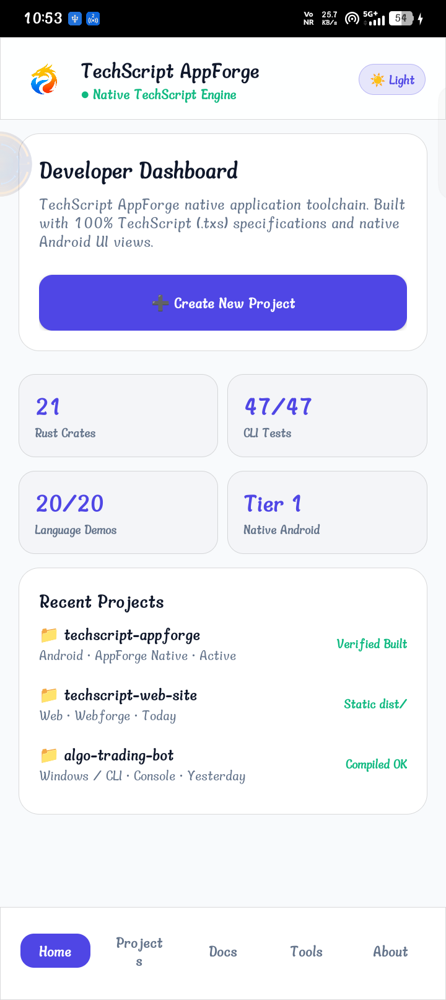

<p align="center">
  
</p>

<h1 align="center">TechScript 2.0</h1>

<p align="center">
  <strong>The Unified General-Purpose Programming Language, Webforge & Appforge Cross-Platform Toolchain</strong>
</p>

<p align="center">
  <a href="https://techscript.is-a.dev/techscript/"></a>
  <a href="https://github.com/Tcode-Motion/techscript/releases"></a>
  <a href="LICENSE"></a>
  <a href="https://github.com/Tcode-Motion/techscript/actions/workflows/ci.yml"></a>
  <a href="docs/TECHSCRIPT_LANGUAGE_REFERENCE.md"></a>
</p>

<p align="center">
  
  <a href="https://github.com/Tcode-Motion/techscript/stargazers"></a>
  <a href="https://github.com/Tcode-Motion/techscript/issues"></a>
  <a href="CONTRIBUTING.md"></a>
</p>

---

## Authoritative Documentation Entry Points

1. 📖 **[TechScript Language Reference](docs/TECHSCRIPT_LANGUAGE_REFERENCE.md)**: Full syntax, grammar, primitives, collections, control flow, functions, classes, error handling, standard library, and support matrix.
2. 🛠️ **[Frameworks & Unified CLI Handbook](docs/FRAMEWORKS_AND_CLI.md)**: Complete guide to `tsc`, Webforge web development, Appforge cross-platform Android & Windows workflows, and native module integration.
3. 🔒 **[Development & Security Guide](docs/DEVELOPMENT_AND_SECURITY.md)**: Compiler pipeline architecture, 21-crate inventory, threat models, capability sandboxing, and quality gates.

---

## Quick-Start Guides

### 1. General-Purpose Program
Create `hello.txs`:
```techscript
do main()
    say "Hello, World from TechScript 2.0!"
end
```
Run it:
```bash
tsc run hello.txs
```

### 2. Full-Stack Website (Webforge)
Scaffold and launch a production-ready website:
```bash
tsc web create my-website
cd my-website
tsc web dev              # Launches live dev server on http://localhost:3000
tsc web build            # Compiles static HTML/CSS/JS to dist/
```

### 3. Native Android App (Appforge)
Create, build, and deploy an Android application:
```bash
tsc app create my-app
cd my-app
tsc app doctor           # Verifies JDK, Android SDK, Gradle, ADB
tsc app build android    # Generates debug APK (build/artifacts/android/app-debug.apk)
tsc app run android      # Installs and launches on attached phone/emulator via ADB
tsc app build windows    # Compiles native Windows executable
```

---

## Verified Platform Support & Maturity

| Platform / Target | Status | Verification Evidence |
| :--- | :--- | :--- |
| **Android APK (Debug)** | **Tier 1 (Verified)** | Built via Gradle 8.7 & AGP 8.6.0; installed and launched on live Android 16 device (`10ME8DF1CT0001Z`) |
| **Android AAB (Release)** | **Tier 1 (Verified)** | Validated ZIP structure and manifest (3.85 MB) |
| **Windows Desktop (.exe)** | **Tier 1 (Verified)** | Executable generation and execution verified on Windows 11 |
| **Webforge (Static Web)** | **Tier 1 (Verified)** | Compiles to semantic HTML, modular CSS, and runtime JS in `dist/` |
| **Web-to-Native Container** | **Tier 1 (Verified)** | `tsc app wrap web --platform android` packages Webforge site into 6.77 MB APK |
| **macOS & iOS** | **Tier 3 (Host Bound)** | Scaffolding implemented; native compilation requires macOS with Xcode |
| **Linux (AppImage/DEB)** | **Tier 3 (Host Bound)** | Scaffolding implemented; native compilation requires Linux host |

---

## 📱 Official TechScript AppForge Application

The official **TechScript AppForge** companion application ([`examples/appforge/techscript-appforge/`](examples/appforge/techscript-appforge/)) is built **100% in pure TechScript (`.txs`)** using AppForge. It features multi-tab routing, reactive project management, an interactive code workspace, language & CLI documentation, build diagnostics, and live Android device hardware bridge communication:

<p align="center">
  
</p>


---

## Unified `tsc` CLI Reference

```text
Appforge (Mobile & Desktop)
  tsc app create <name>       Scaffold a new Appforge application
  tsc app build <platform>    Compile application (android, windows) [--release] [--aab]
  tsc app run <platform>      Build, install, and run on device or desktop host
  tsc app doctor              Audit mobile and desktop development toolchains
  tsc app wrap web            Containerize Webforge website into a native APK/app
  tsc app clean               Clean build outputs and caches

Webforge (Web Framework)
  tsc web create <name>       Scaffold a new Webforge website
  tsc web dev                 Start live development server with hot-reload
  tsc web build               Compile Webforge project to static dist/
  tsc web test                Execute web unit & component tests

Native & Language Interoperability
  tsc native add <lang>       Scaffold native module (kotlin, swift, rust, cpp, c, java)

Development & Compiler
  tsc run <file>              Run a TechScript file or project
  tsc check <file>            Perform semantic check without compiling
  tsc test                    Run test suites (*_test.txs)
  tsc fmt [paths...]          Format source files
  tsc lint [paths...]         Run linter and suggest fixes
  tsc logs                    Inspect centralized build and Gradle task logs
  tsc report                  Generate comprehensive system diagnostics report
```

---

## Frequently Asked Questions (FAQ)

### 1. How do I install TechScript?
On Windows, download the latest pre-compiled `tsc.exe` from [GitHub Releases](https://github.com/Tcode-Motion/techscript/releases) and place it in your `PATH`. Alternatively, clone this repository and run `cargo build --release -p techscript_cli`.

### 2. How do I create and run a basic program?
Create a file named `main.txs` with `do main() say "Hello!" end` and execute `tsc run main.txs`.

### 3. How do I create a website?
Run `tsc web create my-site`. This generates a full Webforge project with `app.txs`, routing, and assets. Run `tsc web dev` to preview on `http://localhost:3000`.

### 4. How do I use CSS, JavaScript, and TypeScript?
In Webforge projects, write standard CSS rules inside the `styles:` block or link custom stylesheets. Client-side JavaScript/TypeScript files can be placed in `assets/` and referenced directly.

### 5. How do I create an Android application?
Run `tsc app create my-app`. This sets up the TechScript entry point, `appforge.toml`, and native Android Gradle host code.

### 6. How do I build APK and AAB files?
- Debug APK: `tsc app build android`
- Release APK: `tsc app build android --release`
- Google Play App Bundle: `tsc app build android --aab`

### 7. How do I run an app on a connected device using ADB?
Connect your phone with USB debugging enabled, then execute `tsc app run android`. `tsc` will automatically compile the APK, deploy it with `adb install -r`, and launch `MainActivity`.

### 8. How do I create a Windows executable?
Inside an Appforge project, execute `tsc app build windows`. The output executable is placed in `build/artifacts/windows/<app-name>.exe`.

### 9. How do I integrate Kotlin, Java, Rust, C, or C++?
Run `tsc native add kotlin` or `tsc native add rust`. Appforge sets up the appropriate Gradle or Cargo module under `native/`.

### 10. How do I add dependencies?
Declare dependencies in `techscript.toml` or `webforge.toml`, then run `tsc install`. `tsc` resolves versions with SemVer, verifies cryptographic checksums, and enforces capability sandboxes.

### 11. How do I debug build errors?
Run `tsc logs` to inspect the raw stdout and stderr logs of compiler and Gradle operations. Run `tsc report` to generate a diagnostic report of your environment.

### 12. Which platforms can I build on Windows?
On Windows 11, you can natively build:
- Android APK & AAB (requires JDK and Android SDK)
- Windows Executables (`.exe`)
- Webforge Production Websites (`dist/`)
- Webforge-to-Android native containers

### 13. Which features are incomplete?
Native iOS (`.ipa`) and macOS (`.dmg`) compilation require an Apple macOS host with Xcode installed. Direct Google Play Store API uploading requires user-supplied production keystores and credentials.

---

## License

TechScript is open-source software licensed under the **Apache License 2.0**.
