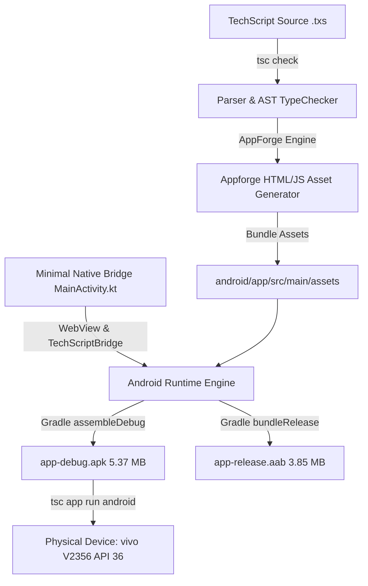

# TechScript 2.0: Frameworks & Unified CLI Handbook

> **Comprehensive Developer Guide for `tsc`, Webforge, and Appforge**  
> Edition: TechScript 2.0 LTS | Unified CLI: `tsc`

---

## 1. Unified `tsc` CLI Overview

TechScript provides a single, discoverable command-line interface executable named `tsc`. All language compilation, web engineering via **Webforge**, and cross-platform native application workflows via **Appforge** are accessed through consistent commands.

```bash
tsc <command> [subcommand] [options]
```

### 1.1 Global Flags
- `--help`, `-h`: Display command overview and usage instructions.
- `--version`, `-v`: Display TechScript toolchain version.
- `--verbose`: Enable comprehensive debug output and subprocess traces.

---

## 2. Core Language & Development Commands

### `tsc run <file>`
Compiles and executes a TechScript file:
```bash
tsc run src/main.txs
tsc run examples/calculator/calculator.txs
```

### `tsc check [file]`
Runs semantic analysis, type checking, and symbol resolution without code generation:
```bash
tsc check src/main.txs
```

### `tsc test [filter]`
Executes test files matching `*_test.txs` or project test suites:
```bash
tsc test
```

### `tsc fmt [paths...]`
Formats `.txs`, `.wtxs`, `.stxs`, and `.3txs` files according to canonical style:
```bash
tsc fmt src/
```

### `tsc lint [paths...]`
Performs static analysis, detects deprecated keywords, and suggests fixes:
```bash
tsc lint src/
```

### `tsc clean`
Cleans build outputs (`build/`, `dist/`), caches (`.tsc-cache/`), and temporary logs:
```bash
tsc clean
```

---

## 3. Webforge: Modern Web Framework

Webforge is TechScript's integrated web framework for responsive websites, server endpoints, and interactive 3D web applications.

### 3.1 Webforge Commands
```bash
# Scaffold a new Webforge website
tsc web create my-website

# Start live development server with hot-reload
cd my-website
tsc web dev

# Compile production-ready static assets to dist/
tsc web build

# Run web tests
tsc web test
```

### 3.2 Output Artifacts
`tsc web build` generates optimized production assets in `dist/`:
- `index.html`: Pre-rendered semantic HTML.
- `styles.css`: Fully resolved CSS with themes and responsive layouts.
- `app.js`: High-performance client-side runtime script.

---

## 4. Appforge: Cross-Platform Native Applications

Appforge enables developers to build real Android APK/AAB packages, Windows desktop executables, and native applications from TechScript source code.

### 4.1 Appforge Commands
```bash
# Scaffold a new cross-platform application
tsc app create my-app
cd my-app

# Inspect required toolchains (JDK, Android SDK, Gradle, ADB)
tsc app doctor

# Build Android Debug APK
tsc app build android

# Build Android App Bundle (AAB) for Google Play Store
tsc app build android --aab

# Build and launch directly on connected Android device via ADB
tsc app run android

# Build Windows native desktop application
tsc app build windows

# Run Windows application
tsc app run windows

# Wrap Webforge website into a native Android APK
tsc app wrap web --platform android
```

### 4.2 Project Structure
```text
my-app/
├── appforge.toml         # App metadata, Android & Windows configuration
├── techscript.toml       # Package dependencies & permissions
├── .gitignore            # Clean git configuration
├── README.md             # Project quick-start instructions
│
├── src/
│   ├── main.txs          # Application entry point
│   ├── app.txs           # Declarative UI layout & theme
│   ├── screens/          # Application screens
│   ├── widgets/          # Custom reusable UI widgets
│   └── state/            # State management
│
├── assets/               # Icons, images, fonts
├── test/                 # Unit & widget tests
│
├── android/              # Native Android host scaffolding
│   ├── gradlew.bat       # Gradle wrapper (Windows)
│   ├── gradlew           # Gradle wrapper (Unix)
│   ├── build.gradle.kts  # Root Gradle configuration
│   └── app/              # Android application module
│       ├── build.gradle.kts
│       └── src/main/java/com/techscript/app/MainActivity.kt
│
└── build/
    └── artifacts/
        ├── android/      # Output .apk and .aab files
        └── windows/      # Output .exe executables
```

### 4.3 Architecture & Build Pipeline



### 4.4 Verified Android Showcase Application

Here is the official **TechScript Showcase App** running live on a physical Android 16 device (`vivo V2356`), demonstrating pure TechScript application logic, the floating spring-physics dock, live hardware stats, and interactive state:

<p align="center">
  
</p>


---

## 5. Native Interoperability (`tsc native add`)

Appforge supports explicit foreign language bindings:

```bash
tsc native add kotlin     # Adds native/kotlin host module
tsc native add rust       # Adds native/rust Cargo module
tsc native add swift      # Adds native/swift module
tsc native add cpp        # Adds native/cpp CMake module
tsc native add c          # Adds native/c module
tsc native add java       # Adds native/java module
```

---

## 6. Centralized Logging & Diagnostics

### `tsc logs`
Inspects stdout and stderr logs from recent builds, Gradle tasks, and compiler passes:
```bash
tsc logs
```

### `tsc report`
Generates a comprehensive markdown system diagnostic report in `reports/system_report.md`:
```bash
tsc report
```

### `tsc app doctor`
Audits the health of all development toolchains:
```bash
tsc app doctor
```

Output Example:
```text
========================================================
           Appforge Toolchain Doctor                    
========================================================
Evaluating mobile, desktop, and cross-platform build environments...

  Java Development Kit (JDK)       ... [ OK ] (javac 21.0.12)
  Android SDK Location             ... [ OK ] (C:\AndroidSDK)
    Platforms Installed:           ["android-34", "android-35", "android-36"]
    Build Tools Installed:         ["34.0.0", "35.0.0", "36.0.0", "37.0.0"]
  Gradle Build Engine              ... [ OK ] (Gradle 8.7)
  Android Debug Bridge (ADB)       ... [ OK ] (Android Debug Bridge version 1.0.41)
    Attached Devices:              1 active device(s)
  Windows Native Toolchain         ... [ OK ]

--------------------------------------------------------
All Appforge mobile and desktop toolchains are healthy and ready!
```

---

## 7. Platform Support Matrix

| Target Platform | Project Generation | Build Target | Execution & Run | Hardware Verification |
| :--- | :--- | :--- | :--- | :--- |
| **Android (APK)** | Supported | Supported (`assembleDebug`) | Supported via ADB | **Verified on Hardware** |
| **Android (AAB)** | Supported | Supported (`bundleRelease`)| Play Console Ready | **Verified Structure** |
| **Windows Desktop** | Supported | Supported (`.exe`) | Supported | **Verified on Windows 11** |
| **Webforge (Web)** | Supported | Supported (`dist/`) | Dev Server & Static | **Verified in Browser** |
| **macOS Desktop** | Supported | Requires macOS Host | Requires macOS Host | Host Restricted |
| **iOS (IPA)** | Supported | Requires Xcode / macOS | Requires macOS Host | Host Restricted |
| **Linux (AppImage)**| Supported | Requires Linux Host | Requires Linux Host | Host Restricted |
