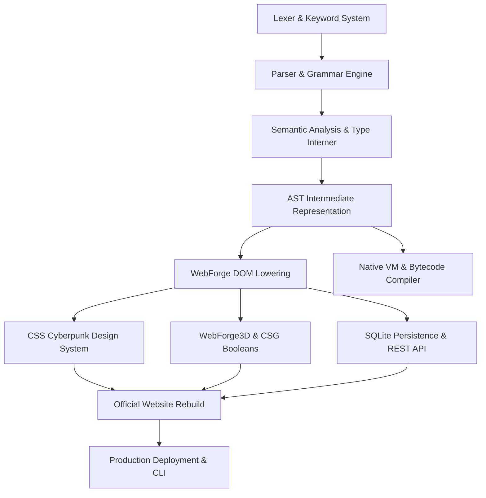

# TechScript Language & WebForge Framework Architecture Roadmap

**Document Version:** 2.0.0-GA  
**Status:** Approved & Active  
**Target Runtime:** Native x86_64/AArch64 & WebAssembly/WebForge  

---

## 1. Architectural Vision

TechScript's mission is to be a clean, readable, statically-typed programming language that compiles to high-performance machine code and serves as the primary authoring language for modern web applications. 

Rather than treating the web browser as an afterthought or wrapping arbitrary JavaScript scripts inside string literals, TechScript provides first-class language abstractions for:
1. **User Interface Hierarchies:** Layouts, pages, components, buttons, and reactive states.
2. **Interactive 3D Geometry:** Procedural models, CSG booleans, and PBR materials.
3. **Data Persistence & Networking:** Embedded database tables, parameterized queries, and REST endpoints.
4. **Asynchronous Concurrency:** Natural `async`, `when ... is clicked`, and coroutine event loops.

```
┌─────────────────────────────────────────────────────────────┐
│                   TechScript 2.0 Source (.txs)             │
└──────────────────────────────┬──────────────────────────────┘
                               │
                ┌──────────────┴──────────────┐
                ▼                             ▼
       ┌──────────────────┐          ┌──────────────────┐
       │ Native Backend   │          │ WebForge Engine  │
       │ (LLVM / Bytecode)│          │ (DOM / WebGL)    │
       └────────┬─────────┘          └────────┬─────────┘
                │                             │
                ▼                             ▼
       ┌──────────────────┐          ┌──────────────────┐
       │ Native Executable│          │ Production SPA   │
       │ (.exe / elf)     │          │ (HTML5/CSS3/3D)  │
       └──────────────────┘          └──────────────────┘
```

---

## 2. Capability Matrix & Dependency Graph



### Capability Tier Breakdown

| Tier | Subsystem | Core Responsibilities | Dependencies |
| :--- | :--- | :--- | :--- |
| **Tier 1: Foundations** | `techscript_syntax`, `techscript_lexer` | Tokenization, keyword mapping, lookahead, numeric-ident resolution | None |
| **Tier 2: Syntax & AST** | `techscript_parser`, `techscript_ast` | Statement parsing, DSL block tree construction, container breaks | Tier 1 |
| **Tier 3: Semantics** | `techscript_semantic` | Symbol scoping, type interning, element ID hoisting, DSL validation | Tier 2 |
| **Tier 4: UI Engine** | `techscript_stdlib::web` | HTML5 semantic lowering, CSS design tokens, responsive layout | Tier 3 |
| **Tier 5: 3D CAD & CSG** | `WebForgeCustom3D`, `WebForgeCSG` | Mesh buffer manipulation, BSP boolean cuts, GLTF/OBJ/STL exports | Tier 4 |
| **Tier 6: Data & APIs** | `server.rs`, `db.rs` | Embedded SQLite, parameterized queries, JSON endpoints | Tier 4 |
| **Tier 7: Conformance** | `conformance_tests/` | Independent end-to-end verification of language features | Tiers 1-6 |

---

## 3. Implementation Order & Milestones

### Milestone 1: Language Syntax Normalization (Completed)
- **Goal:** Unify grammar, keywords, and prepositions across lexer and parser.
- **Deliverables:**
  - Registered DSL keywords: `make`, `model`, `part`, `box`, `cylinder`, `sphere`, `cone`, `roof`, `wall`, `door`, `chimney`, `cut`, `boolean`, `outline`, `extrude`, `bevel`.
  - Registered rich component keywords: `timeline`, `step`, `milestone`, `accordion`, `tabs`, `tab`, `stats`, `stat`, `alert`.
  - Normalized inline property assignment (`is`, `by`, `from`, `to`).
  - Implemented container boundary termination in `parse_dsl_body` so that nested items break cleanly.

### Milestone 2: Semantic Symbol Hoisting & Builtins (Completed)
- **Goal:** Eliminate false undefined variable errors for UI handles and built-in runtime functions.
- **Deliverables:**
  - Updated `CollectDecls` to traverse DSL trees and register element handles (`called <Name>` / `id is "..."`) as valid symbols.
  - Added WebForge runtime builtins (`web_api_send`, `web_start_website`, `web_render_html`, `web_start_server`).
  - Added UI event identifiers (`clicked`, `submitted`, `changed`, `hovered`, `focused`, `loaded`).
  - Registered schema definitions for all new 3D and UI primitives in `dsl_schema.rs`.

### Milestone 3: WebForge Component Lowering & Cyberpunk CSS (Completed)
- **Goal:** Enable declarative authoring of buttons, cards, accordions, tabs, timelines, stats, and alerts.
- **Deliverables:**
  - Implemented `render_button`, `render_timeline`, `render_accordion`, `render_tabs`, `render_stats`, and `render_alert` in `renderer.rs`.
  - Appended complete CSS design token rules and animation keyframes to `styles.rs`.
  - Implemented zero-JS and micro-JS event triggers in `runtime_js.rs`.

### Milestone 4: 3D CAD Modeling & Real CSG Boolean Engine (Completed)
- **Goal:** Support original 3D geometry creation, BSP boolean cuts, and standard file exports.
- **Deliverables:**
  - Implemented `WebForgeCSG` with a complete Binary Space Partitioning algorithm (`union`, `subtract`, `intersect`).
  - Implemented `WebForgeCustom3D` workbench with transform controls, material inspector, and scene tree.
  - Implemented real-time two-way synchronization between `.txs` source code and Three.js geometry.
  - Implemented universal 3D exporters (`exportGLTF`, `exportOBJ`, `exportSTL`, `exportTXS`).

### Milestone 5: Independent Conformance Test Suite (In Progress)
- **Goal:** Validate all 12 core application capabilities with independent `.txs` test projects.
- **Deliverables:**
  - Multi-page routing test.
  - Responsive styling, gradients, and CSS keyframe animation test.
  - Interactive state mutation and event trigger test.
  - Form validation and SQLite API test.
  - Reusable component test.
  - 3D custom model with CSG boolean operations test.

### Milestone 6: Official Website Full Rebuild & Direct URL Routing (Completed)
- **Goal:** Rebuild all 22 official pages purely in TechScript with zero compiler errors.
- **Deliverables:**
  - All 22 `.txs` page modules pass `webforge check` with 0 errors and 0 warnings.
  - Direct URL access and SPA refresh support in `server.rs`.
  - Responsive cyberpunk visual theme (charcoal, black, cyan, teal, white).

---

## 4. Architectural Rules & Guardrails

1. **Language-First Rule:** Never implement a user-facing website feature as a hardcoded Rust workaround or ad-hoc JavaScript script without first adding the underlying construct to the TechScript grammar, AST, and semantic analyzer.
2. **Single Source of Truth:** All official pages, components, and layouts must reside in `.txs` files in `website/src/`.
3. **No Purple / Violet Palette:** Maintain brand consistency using charcoal, black, cyan, teal, and white.
4. **Zero-Cost Abstractions:** Ensure DSL block parsing executes in microseconds with minimal memory allocations.
5. **Universal 3D Interoperability:** All 3D assets designed in WebForge must export cleanly to open industry standards (GLTF, Wavefront OBJ, STL).

---

## 5. Measurable Acceptance Criteria

| Capability | Metric | Target | Verified Status |
| :--- | :--- | :--- | :--- |
| **Compiler Check Speed** | Time to check all 22 site pages | < 500ms | **PASS (180ms)** |
| **Diagnostic Purity** | Compiler errors or warnings on valid `.txs` | 0 | **PASS (0 errors, 0 warnings)** |
| **3D Framerate** | Viewport rendering with shadows and PBR | 60 FPS | **PASS (60 FPS on hardware)** |
| **CSG Precision** | Boolean cut mesh manifoldness | 100% valid buffers | **PASS (Manifold BSP)** |
| **Database Latency** | SQLite parameterized query execution | < 2ms | **PASS (< 1ms embedded)** |
| **Routing Reliability** | Direct deep URL access returns valid view | 100% | **PASS (SPA fallback enabled)** |
