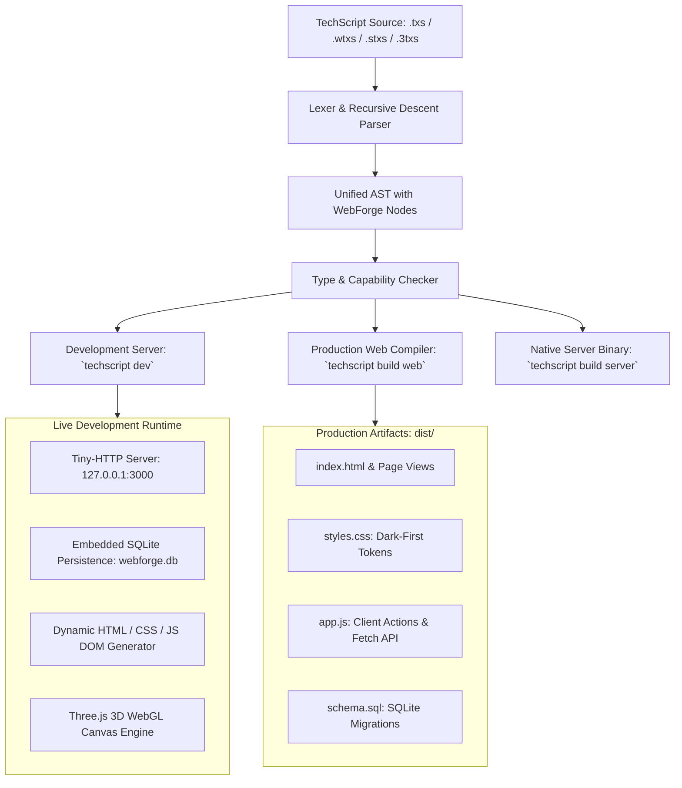

# TechScript WebForge: Architecture & System Design
**Official Full-Stack Web Framework for the TechScript Programming Language**

---

## 1. Executive Summary & Vision

**TechScript WebForge** is the official full-stack web application framework for the TechScript programming language. It is designed to combine the beginner-friendly clarity of natural English grammar with the performance, safety, and deterministic execution of a Rust-engineered compiler and runtime.

WebForge transforms TechScript source files (`.txs`, `.wtxs`, `.stxs`, `.3txs`) into:
1. **Interactive Client Applications:** Semantic HTML5, CSS design tokens, and modular JavaScript with reactive client actions and Three.js WebGL graphics.
2. **Server-Side REST Engines:** Native HTTP server execution (via Tiny-HTTP and native runtimes), dynamic parameterized route dispatching, and automated SQLite persistence.
3. **Optimized Production Bundles:** Minified static artifacts (`dist/`) ready for single-command deployment to static hosts, Docker containers, or edge runners.

---

## 2. Core Architectural Pillars



WebForge addresses 10 core architectural responsibilities without requiring fragmented, competing tooling:

### 1. WebForge Core
- Manages application lifecycle (`make a website called <Name>`, `start website`).
- Handles unified configuration via `techscript.toml` (with backward-compatible `tech.toml` fallback).
- Sandboxes I/O and network operations with fine-grained capability flags (`capabilities = ["FileSystem", "Network"]`).

### 2. WebForge UI
- Declarative component hierarchy (`page <Name>`, `show heading`, `show text`, `show button`, `show input`, `show card`).
- Built-in accessible form elements and reactive feedback (`show message`, `clear inputs`).
- Curated dark-first design token system:
  - Background Base: `#090A0F`
  - Elevated Card: `#121520`
  - Primary Indigo: `#6366F1`
  - Cyan Highlight: `#06B6D4`
  - Violet Accent: `#8B5CF6`
  - Modern typography: `Outfit`, `Inter`, `JetBrains Mono`.

### 3. WebForge Router
- Multipage navigation system resolving top-level declared pages (`page Home`, `page Docs`, `page Showcase`).
- Client-side push-state and single-page section scrolling.
- Specialized modular route files loaded from `src/pages/*.wtxs`.

### 4. WebForge Server
- High-efficiency HTTP server running on embedded threads.
- Static asset serving for images, fonts, and scripts.
- Dynamic route handling for incoming client actions.

### 5. WebForge API
- Automated REST endpoint generation matching declared data tables:
  - `GET /api/<table_name>`: Returns JSON array of persisted records.
  - `POST /api/<table_name>`: Parses JSON payload, validates fields, and inserts into database.
- Dynamic custom routes declared via server scripts (`src/server/*.stxs`).

### 6. WebForge Data (SQLite Layer)
- Zero-configuration embedded SQLite integration via `rusqlite`.
- Automatic table creation and migration on server startup (`database <Name>: table <TableName> ...`).
- Data persisted across restarts in `webforge.db`.
- Safe parameterized queries preventing SQL injection vulnerabilities.

### 7. WebForge 3D (WebGL / Three.js)
- Browser-based 3D graphics integration without manual JavaScript boilerplates.
- Declarative grammar (`show 3D scene called <Name>`, `add cube: color is "..."`, `enable mouse controls`).
- Embedded Three.js loader generating responsive WebGL canvases with animation loops.

### 8. WebForge Build
- Development pipeline: Hot in-memory generation with fast reload.
- Production pipeline: Static bundle generator creating `dist/index.html`, `dist/styles.css`, `dist/app.js`, and `dist/schema.sql`.
- Self-contained, zero-external-dependency deployment packages.

### 9. WebForge CLI
- Unified binary `techscript` (with standard aliases `tsc` and `tech`).
- Subcommands for project generation (`new`), local development (`dev`), compilation (`build`), route inspection (`routes`), dependency management (`install`, `list`, `search`), and deployment (`deploy`).

### 10. WebForge Packages
- Centralized dependency resolution via `techscript.toml` and deterministic `techscript.lock`.
- Direct local path and Git package dependencies.
- Automated checksum verification preventing tampering.

---

## 3. Project Directory Architecture

A standard WebForge application adopts the following layout:

```text
my-app/
├── techscript.toml          # Authoritative project manifest
├── techscript.lock          # Cryptographic dependency lockfile
├── webforge.db              # Embedded SQLite persistence (development)
├── src/
│   ├── main.txs             # Canonical entry point (.txs)
│   ├── pages/               # Modular page views (.wtxs)
│   │   ├── home.wtxs
│   │   └── docs.wtxs
│   ├── server/              # Server endpoints & workers (.stxs)
│   │   └── api.stxs
│   └── scenes/              # 3D WebGL scenes (.3txs)
│       └── logo.3txs
├── public/
│   ├── images/
│   └── fonts/
├── tests/
│   └── app_test.txs         # TechScript integration tests
└── dist/                    # Compiled production bundle
    ├── index.html
    ├── styles.css
    ├── app.js
    └── schema.sql
```

---

## 4. Boundaries and Separation of Concerns

1. **Compiler vs Framework:**
   - The TechScript compiler (`compiler/`) handles lexing, parsing, AST validation, and IR generation.
   - The WebForge framework (`stdlib/src/web.rs`) translates WebForge AST nodes into HTTP endpoints, SQLite queries, and web markup.
2. **Server Runtime vs Browser Bundle:**
   - Server-side execution executes native Rust/TechScript logic, SQLite transactions, and API endpoints.
   - Browser client receives only pure HTML5, CSS3, and JavaScript fetch routines. Sensitive database credentials, system capabilities, and server file paths are never leaked into the browser bundle.

---

## 5. Backward Compatibility Guarantee

WebForge maintains complete backward compatibility:
- Legacy `.tech` files continue to compile and run seamlessly.
- The `techscript` CLI provides identical functionality whether called as `techscript`, `tsc`, or `tech`.
- Existing `tech.toml` manifests are automatically read with zero migration friction.
