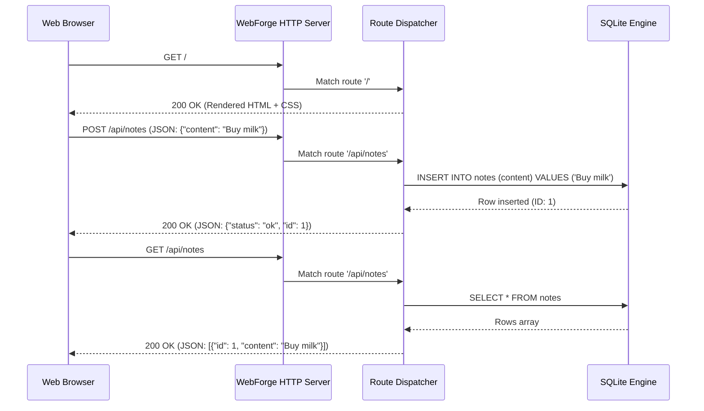

# TechScript WebForge: Backend & Server Runtime
**Embedded HTTP Engine, Request Lifecycle, and Server Execution**

---

## 1. Overview

WebForge is not merely a static site generator. It includes a native, embedded server engine implemented in Rust (`stdlib/src/web.rs`) that runs both during local development (`techscript dev`) and inside compiled server executables.

---

## 2. Server Architecture & Lifecycle



---

## 3. Server Execution Modes

### A. Development Server (`techscript dev`)
- Default port: `3000` (customizable via `techscript dev --port 8080`).
- Serves dynamic HTML, automatically injects client JavaScript, manages SQLite connections, and logs all incoming requests in real time.

### B. Production Server Bundle
- Compiled via `techscript build server --release` or deployed via container runtimes.
- Uses multi-threaded worker pools to handle concurrent client requests.

---

## 4. Specialized Server Files (`.stxs`)

For dedicated backend services, background workers, or scheduled daemons, place server logic in `src/server/*.stxs`:

```techscript
// src/server/api.stxs
database Users:
    table users:
        username is text
        email is text
        created_at is datetime
```

The WebForge compiler binds `.stxs` modules into the server execution graph without exposing server-only database connection strings or internals to the client bundle.
