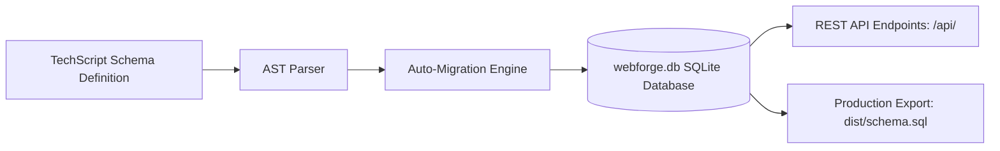

# TechScript WebForge: Database & Persistence Layer
**Embedded SQLite Storage, Schema Migrations, and Safe Data Handling**

---

## 1. Overview & Architecture

WebForge includes a native database integration powered by embedded SQLite (`rusqlite`). It provides true local data persistence across server restarts without requiring complex external database server installations, Docker containers, or environment setup.



---

## 2. Defining Schemas in TechScript

To define a database table, use the `database` and `table` blocks:

```techscript
database Store:
    table products:
        name is text
        price is number
        in_stock is boolean
```

### Supported Data Types
| TechScript Type | SQLite Column Type | Notes |
| :--- | :--- | :--- |
| `text` | `TEXT` | String, markdown, or large text |
| `number` | `REAL` / `INTEGER` | Numeric values and counters |
| `boolean` | `INTEGER` (0 or 1) | True/False flags |
| `datetime` | `TEXT` (ISO-8601) | Timestamps and dates |

Each table is automatically assigned a primary key column (`id INTEGER PRIMARY KEY AUTOINCREMENT`).

---

## 3. Automated Migration System

When WebForge starts (`techscript dev`), the embedded engine:
1. Inspects `webforge.db`.
2. Compares existing table structures against your declared TechScript schema.
3. Automatically executes `CREATE TABLE IF NOT EXISTS` statements with correct types and constraints.
4. Preserves all existing records seamlessly.

When building for production (`techscript build web --release`), WebForge generates `dist/schema.sql`:
```sql
-- Generated by TechScript WebForge Compiler
CREATE TABLE IF NOT EXISTS products (
    id INTEGER PRIMARY KEY AUTOINCREMENT,
    name TEXT,
    price REAL,
    in_stock INTEGER
);
```

---

## 4. Security & Parameterized Queries

WebForge guarantees protection against SQL injection attacks:
- All dynamic query parameters are passed via SQLite bound variables (`?1`, `?2`, etc.).
- Never concatenates user inputs directly into raw SQL strings.
- Table names are validated against the declared AST whitelist.

---

## 5. Development vs Production

- **Development:** Uses `webforge.db` in the project root directory. You can inspect it directly using SQLite CLI tools (`sqlite3 webforge.db`).
- **Production:** Deploy the compiled `dist/schema.sql` to your production SQLite, LibSQL/Turso, or compatible relational database adapter.
