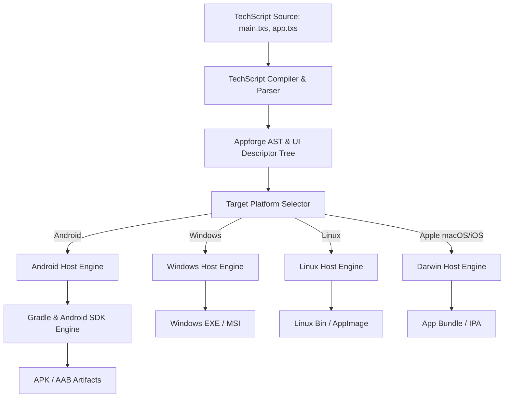

# Appforge Architecture Specification

**Framework**: TechScript Appforge  
**Version**: 2.0.0  
**Target Runtimes**: Android, iOS, Windows, macOS, Linux, Web  
**CLI Driver**: `tsc app`  

---

## 1. System Vision & Boundaries

Appforge is TechScript's unified cross-platform application framework. While **Webforge** focuses on web development (HTML5/CSS3/WebGL/SQLite serverless single-page and multi-page web applications), **Appforge** provides the runtime, UI widget tree, native platform hosts, and build orchestration to generate, compile, package, sign, and install native applications across:

1. **Android**: Native APK (`.apk`) and Android App Bundle (`.aab`) via Gradle, Android SDK, and Kotlin host bridge.
2. **Windows**: Native executable (`.exe`) and MSI installer via MSVC/GCC and Win32/DirectX/WebView2 host.
3. **Linux**: Native executable, AppImage, and DEB/RPM packages via GTK/Wayland/WebKit host.
4. **macOS**: App bundle (`.app`) and DMG via Apple toolchains.
5. **iOS**: Xcode archive (`.xcarchive`) and IPA (`.ipa`) via macOS toolchains.
6. **Web Wrapping**: Native mobile & desktop containerization of Webforge projects (`tsc app wrap web`).

---

## 2. Core Architectural Components



### 2.1 The Application Lifecycle
An Appforge application is managed through a lifecycle controller:
- **`on_init()`**: Allocates memory, initializes state stores, loads platform configuration.
- **`on_launch()`**: Prepares the UI tree, initializes hardware-accelerated render surface.
- **`on_resume()`**: Regains foreground window focus and attaches device event hooks.
- **`on_pause()`**: Suspends intensive background rendering, saves state snapshots.
- **`on_destroy()`**: Flushes caches, closes database connections, frees native resources.

### 2.2 Declarative UI & Widget System
Appforge uses a declarative syntax compatible with TechScript's canonical style:
```techscript
app "MyNotes":
    theme:
        primary is "#4f46e5"
        background is "#0f172a"
        text is "#f8fafc"

    screen Home:
        navbar:
            title is "TechScript Appforge"
            action "Settings" -> open_settings()

        column:
            padding is 16
            spacing is 12

            card:
                heading "Welcome to Appforge"
                text "Build Android APKs and cross-platform native apps with TechScript."

            input "Enter note title..." called NoteTitle
            button "Create Note":
                on_click:
                    save_note(NoteTitle.value)
```

### 2.3 Runtime Execution Models
Appforge supports three distinct compilation & execution strategies:
1. **Bytecode Bundle & Embedded Engine (Default Android & Desktop)**:
   - TechScript code is compiled into optimized bytecode (`.tsc` / `.tsb` bundle) with embedded asset tables.
   - The platform host (e.g. Android Kotlin activity or Windows native wrapper) executes the bundle via the TechScript runtime engine.
   - Zero external JVM runtime dependencies; runs on standard Android Runtime (ART) using Kotlin host bridge.
2. **Hybrid Web Container (`tsc app wrap web`)**:
   - Webforge applications are compiled to optimized web assets (`dist/`), embedded in the native app's local asset bundle, and rendered via a high-performance local WebView with an asynchronous native RPC bridge.
3. **Ahead-of-Time Native Machine Code (LLVM)**:
   - For platforms with configured LLVM toolchains, compiles directly to object files and links against `libtechscript_native`.

---

## 3. Platform Abstraction Layer (PAL)

The Platform Abstraction Layer provides uniform APIs across all supported OS targets:
- **`app.platform.info()`**: OS name, architecture, version, device model.
- **`app.storage.local()`**: Key-value encrypted preferences and filesystem paths.
- **`app.dialog.alert(msg)` / `confirm(msg)`**: Native platform modal dialogs.
- **`app.network.fetch()`**: TLS HTTP client delegating to native platform networking (OkHttp on Android, WinINet/ureq on Windows).
- **`app.haptics.vibrate()`**: Device vibration and tactile feedback.
- **`app.clipboard.read()` / `write()`**: System clipboard interaction.
- **`app.permissions.request(perm)`**: Runtime Android/iOS permission management.

---

## 4. Native Language Interoperability Architecture

Appforge provides explicit, modular native language integration directories under `native/`:
- **`native/kotlin/`**: Android Kotlin extension classes and JNI hooks.
- **`native/java/`**: Legacy Android/JVM libraries.
- **`native/swift/`**: iOS/macOS Swift modules and Apple frameworks.
- **`native/rust/`**: High-performance cross-compiled C-ABI shared libraries (`.so`, `.dll`, `.dylib`).
- **`native/cpp/` & `native/c/`**: Native C/C++ libraries compiled via NDK (Android) or MSVC/GCC (Desktop).

The CLI command `tsc native add <lang>` generates appropriate scaffolding, header bindings, and Gradle/CMake build rules.

---

## 5. Security & Isolation Architecture

1. **Explicit Permission Manifesting**: No permissions are requested by default. Permissions (Camera, Internet, Storage, Location) must be explicitly listed in `appforge.toml`.
2. **Origin-Restricted Webview Bridge**: In `tsc app wrap web`, JavaScript only communicates with the native host through a cryptographically validated nonce-based message channel. Arbitrary external URLs cannot access native APIs.
3. **Zero Secrets in Repository**: Build configurations and signing manifests strictly separate release keystores and passwords, storing sensitive paths in environment variables or user keystore files outside source control.
