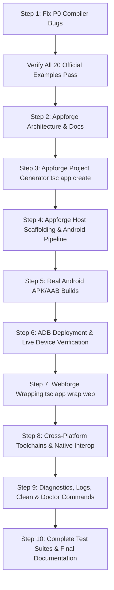

# TechScript 2.0 & Appforge Implementation Roadmap

**Document Path**: `docs/audits/implementation-roadmap.md`  
**Classification**: Implementation Plan  
**Status**: Ready for Execution  

---

## 1. Sequence of Work

---

## 2. Milestone Breakdown

### Milestone 1: P0 Compiler Bug Fixes (COMP-01 & COMP-02)
- **Goal**: Restore 100% pass rate across the official TechScript 2.0 example suite.
- **Actions**:
  1. Modify `compiler/parser/src/statements.rs` to prevent `when` expressions from prematurely terminating active blocks.
  2. Modify `compiler/parser/src/parser.rs` and `compiler/parser/src/statements.rs` so `data` assignment statements parse as expression assignments rather than DSL blocks.
  3. Run `python verify_all_examples.py` and ensure 20/20 examples pass.

### Milestone 2: Appforge Core Architecture & Project Scaffolding (APP-01, CLI-01)
- **Goal**: Enable `tsc app create <name>` to generate complete, modern TechScript mobile & desktop applications.
- **Actions**:
  1. Add `App` subcommand group to `cli/src/lib.rs` and `cli/src/entrypoint.rs`.
  2. Implement `cli/src/commands/app/` with subcommands: `create`, `build`, `run`, `test`, `doctor`, `wrap`, `clean`.
  3. Define standard Appforge project templates with `appforge.toml`, `techscript.toml`, `src/main.txs`, `src/app.txs`, `assets/`, `test/`, and native host directories (`android/`).

### Milestone 3: Android Build Engine (APP-02)
- **Goal**: Real compilation of TechScript apps to Android APK and AAB.
- **Actions**:
  1. Create the Android host scaffolding:
     - Android Gradle build files (`build.gradle.kts`, `settings.gradle.kts`, `gradle.properties`)
     - Android Manifest with proper package name and permissions
     - Kotlin/Java host activity and application classes
     - TechScript runtime loader and UI bridge
     - Gradle wrapper (`gradlew.bat`, `gradle/wrapper/gradle-wrapper.jar`)
  2. Implement `tsc app build android`:
     - `--debug`: invokes Gradle `assembleDebug` to produce verified `.apk`
     - `--release`: invokes Gradle `assembleRelease` to produce verified release `.apk`
     - `--aab`: invokes Gradle `bundleRelease` to produce verified `.aab`
  3. Verify output files using ZIP structure analysis, size check, and manifest validation.

### Milestone 4: Live Device Execution & ADB Verification (APP-03)
- **Goal**: Install and launch the generated application on the attached physical Android device (`10ME8DF1CT0001Z`).
- **Actions**:
  1. Implement `tsc app run android [--device <id>]`:
     - Discovers ADB devices
     - Builds debug APK
     - Installs via `adb install -r`
     - Launches main activity via `adb shell am start`
     - Streams logs via `adb logcat`
  2. Perform live verification on the attached phone.

### Milestone 5: Webforge Web Wrapping (WEB-01)
- **Goal**: Package Webforge projects as native Android apps via `tsc app wrap web --platform android`.
- **Actions**:
  1. Add Webforge compilation hook that bundles `dist/` into the Android host's `assets/` directory.
  2. Configure native WebView host with asset streaming, hardware acceleration, and security isolation.
  3. Compile and verify wrapped APK.

### Milestone 6: Language Interoperability & CLI Diagnostics (CLI-02)
- **Goal**: Implement `tsc native add <lang>`, `tsc logs`, `tsc report`, `tsc app doctor`.
- **Actions**:
  1. Implement native bridge scaffolding for Kotlin, Swift, Rust, C++, C, Java.
  2. Implement build logging, error reporting, and toolchain verification.

### Milestone 7: Verification & Final Acceptance
- **Goal**: Complete test suite pass, zero regressions, full documentation.
